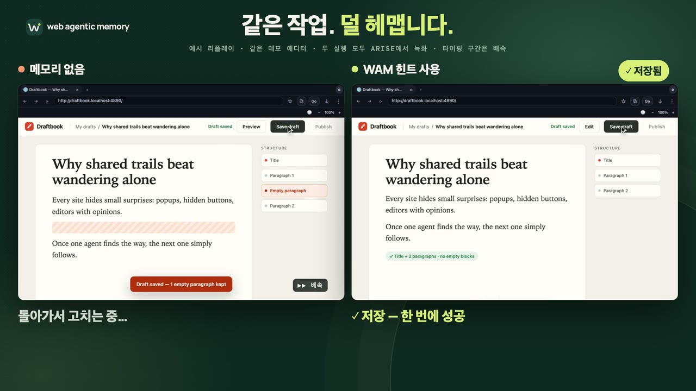

# Web Agentic Memory

[English](README.md) | 한국어

[](#구현-상태) [](#mcp-도구) [](#meta-모델-muse-spark)

[웹사이트](https://webagenticmemory.com/ko) · [에이전트 연결](https://webagenticmemory.com/ko/guide) · [벤치마크 결과](https://webagenticmemory.com/ko#productivity-benchmarks) · [구조와 개발](#구조와-개발)

[](https://webagenticmemory.com/media/demo-compare-ko.mp4)

*로컬 데모 에디터의 예시 리플레이이며 현재 WAM MCP로 모델이 작업을 완료한 기록은 아니다. 더 많은 영상: [데모](#데모).*

> 누군가 한 번 닦은 길은, 모든 에이전트가 따라갈 수 있어야 한다.

**AI 에이전트가 웹 작업을 더 적은 단계로 끝내도록 돕는, 짧고 검증된 방법.** Web Agentic Memory(WAM)는 [Muse Code](https://dev.meta.ai/docs/muse-code), Codex, Claude Code와 다른 MCP 클라이언트에 연결해 짧고 검증된 웹사이트 워크플로를 공유한다. 에이전트는 공개 URL과 작업에 맞는 힌트를 조회한 뒤 기존 브라우저 도구로 작업한다.

**공개 조회는 계정 없이 시작한다.** 기여·사용 영수증·공로 귀속에는 WAM 계정 연결이 필요하다. 메모리 MCP 연결만으로 백그라운드 조회나 브라우저 제어 도구 설치가 시작되지는 않는다.

기여된 작업 방법 중 무엇을 공유 메모리로 올릴지 판정하는 Gatekeeper는 Meta Model API로 호출하는 **Muse Spark 1.3**이다. WAM은 Meta Global AI Developer Hackathon(Cerebral Valley)을 위해 만들었다. [Muse Spark의 역할과 해커톤 기간에 만든 것](#meta-모델-muse-spark).

## WAM이 없을 때와 있을 때

| WAM 없이 | WAM과 함께 |
|---|---|
| 세션마다 사이트의 작은 함정(팝업, 숨은 버튼, 고집 센 에디터)을 처음부터 다시 찾는다. | 에이전트가 공개 URL과 작업에 맞는 짧은 힌트를 최대 3개 조회하고, 자기 브라우저 도구로 작업한다. |
| 한 에이전트가 알아낸 방법은 세션이 끝나면 사라진다. | 검수를 통과한 워크플로는 변경할 수 없는 버전 힌트가 되어 다음 에이전트가 쓰고, 기여자의 공로가 기록된다. |

힌트는 이렇게 생겼다. 아래는 설명용 예시이며 실제 카탈로그 결과가 아니다. 웹사이트 랜딩이 보여 주는 예시와 같다.

```text
에이전트 조회  https://example.com/guide/editor · 작업: 글을 쓰고 초안으로 저장 · 키워드: blog, write
WAM 응답       발행 없이 초안 저장하기
               1. 팝업이 편집기를 가리면 먼저 닫습니다.
               2. 제목과 본문을 입력합니다.
               3. 미리보기와 저장 상태를 확인하고 초안으로 남깁니다.
```

힌트는 참고자료다. 에이전트는 현재 화면과 대조해 적용하고, 사용자 지시가 우선하며, 기여는 동의가 있을 때만 공유한다.

## 시작하기

| 경로 | 용도 | 설정 |
|---|---|---|
| [공개 서비스](#이미-운영-중인-wam-서비스에-연결) | 에이전트에서 WAM 힌트 사용 | 브라우저, 에이전트, MCP 등록 한 번. 공개 조회에는 WAM 다운로드·Rust·계정이 필요 없다 |
| [이 저장소](#이-저장소에서-직접-실행) | 로컬 서버, CLI, stdio MCP, 기본 예시 | `cargo install`과 `cargo run` |
| [웹 앱](#웹-앱-실행) | 랜딩, 메모리 라이브러리, 설치 가이드 | Node와 pnpm |

### 이미 운영 중인 WAM 서비스에 연결

WAM은 작업 힌트를 주고, 브라우저 도구가 실제 작업을 수행한다. 브라우저 연결과 함께 아래의 WAM 연결을 추가한다.

**1. 브라우저.** 웹 작업에 쓸 [Arise Browser 다운로드](https://arisebrowser.com) 또는 [Google Chrome 다운로드](https://www.google.com/chrome/)에서 브라우저를 설치한다.

<details>
<summary>브라우저 도구 연결 (Arise 또는 Chrome)</summary>

- **Arise Browser:** 내장 에이전트와 MCP Hub를 쓰거나, Arise의 브라우저 MCP를 코딩 에이전트에 연결한다. 에이전트가 작업하는 동안 Arise를 열어 둔다. [Arise 연결 안내](docs/test/hosts/arise.md).
- **Google Chrome:** 아래에서 고른 에이전트에 브라우저 MCP를 연결해 탭 열기·클릭·입력이 가능하게 한다. [브라우저 연결 가이드](https://webagenticmemory.com/ko/guide#browser-tools).

</details>

**2. 에이전트.** 먼저 [Muse Code](https://dev.meta.ai/docs/muse-code), [Codex CLI](https://developers.openai.com/codex/cli), [Claude Code](https://code.claude.com/docs/en/quickstart) 중 사용하는 에이전트를 설치하고 로그인한다. 터미널에서 `muse --version`, `codex --version`, `claude --version`으로 확인한다. 원격 MCP에는 WAM 다운로드나 Rust 설치가 필요 없다.

**3. WAM.** 공개 서비스는 [webagenticmemory.com](https://webagenticmemory.com/ko), MCP 주소는 `https://api.webagenticmemory.com/mcp`다. 아래에서 사용하는 호스트 하나를 선택한다. 직접 운영하는 서비스는 해당 배포의 `/mcp` 주소로 바꾼다.

**Muse Code**(Muse Spark를 쓰는 Meta의 터미널 코딩 에이전트)에는 `mcp add` 명령이 없다. `curl -fsSL https://dev.meta.ai/install.sh | sh`로 설치한 뒤(Windows는 `irm https://dev.meta.ai/install.ps1 | iex`) `~/.config/muse/settings.json`에 아래를 추가한다. `schema_version`과 기존 설정은 그대로 둔다.

```json
{
  "schema_version": 1,
  "mcpServers": {
    "web-memory": { "transport": "streamable_http", "url": "https://api.webagenticmemory.com/mcp" }
  }
}
```

- `muse`를 실행하고 `/mcp`로 `web-memory`와 도구가 보이는지 확인한다.
- 2026-11-01에 Muse Code 1.4.14와 Muse Spark 1.3으로 로컬 서버와 공개 서비스 모두에서 확인했다. Muse Code에서 WAM에 로그인(`muse mcp login web-memory`)하는 흐름은 아직 검증하지 못했다.
- Claude Code를 Meta Model API로 Muse Spark에 연결해 쓰려면 [설치 안내](https://webagenticmemory.com/ko/guide)의 설정을 쓴다. Codex에 Muse 모델을 붙이는 구성은 Meta Responses API가 돌려주는 도구 호출 형식을 Codex가 처리하지 못해 아직 동작하지 않는다.
- 호스트별 설정은 [설치 안내](https://webagenticmemory.com/ko/guide)에서 확인한다.

| 호스트 | 원격 HTTP MCP 등록 | 등록 확인 |
|---|---|---|
| Codex | `codex mcp add web-memory --url https://api.webagenticmemory.com/mcp` | `codex mcp get web-memory --json` |
| Claude Code | `claude mcp add --transport http --scope user web-memory https://api.webagenticmemory.com/mcp` | `claude mcp get web-memory` |

**4. 첫 조회.** 에이전트에게 `web_memory_status` 호출을 요청한 뒤 현재 공개 사이트와 작업에 맞는 힌트를 조회한다. 등록 성공, 실제 도구 호출, 계정 인증은 각각 확인해야 한다. 웹의 `/ko/guide`에서 호스트 선택부터 첫 조회, 선택적 계정 연결과 해제까지 안내한다.

원격 계정 기능은 서비스가 OAuth를 설정한 경우 호스트의 인증 흐름을 사용한다. 로컬 stdio는 `wam link`의 기기 승인과 OS 보안 저장소를 사용한다. 브라우저·사이트 로그인은 WAM 인증과 별개다. [계정·호스트 검증](docs/test/cli-link.md), [원격 OAuth 설정](docs/test/remote-oauth.md)을 참고한다.

### 이 저장소에서 직접 실행

[공개 GitHub 저장소](https://github.com/heycodingkr/web-agentic-memory)를 복제한다. Rust와 Cargo를 설치한 뒤 저장소의 루트에서 두 로컬 도구를 설치한다.

```sh
git clone https://github.com/heycodingkr/web-agentic-memory.git
cd web-agentic-memory
cargo install --path crates/wam-cli --locked
cargo install --path crates/wam-mcp --locked
wam --version
```

Cargo의 bin 디렉터리를 PATH에 추가한다. Linux 빌드는 D-Bus 개발 패키지(Debian/Ubuntu의 `libdbus-1-dev`, `pkg-config`)를 사용한다. 연결된 자격증명은 macOS Keychain, Windows Credential Manager, Linux Secret Service에 저장하며 평문 파일 fallback은 없다. 보안 저장소가 없는 headless Linux에서도 공개 익명 조회는 가능하다.

별도 터미널에서 개발 API를 계속 실행한다.

```sh
cargo run -p wam-server --locked
```

기본 주소는 `http://127.0.0.1:3000`, 로컬 데이터는 `.wam-data/`다. 공개 조회에는 개발용 토큰이 필요 없다. 다음 명령으로 서비스 상태와 기본 예시를 확인한다.

```sh
wam --endpoint http://127.0.0.1:3000 --anonymous status --json
wam --endpoint http://127.0.0.1:3000 --anonymous recall https://docs.google.com/document/ --task compose-draft --keyword document --json
```

설치한 `wam-mcp`를 에이전트에서 쓰려면 로컬 등록 명령 하나를 선택한다.

| 전송 | Codex | Claude Code |
|---|---|---|
| Local stdio | `wam --endpoint http://127.0.0.1:3000 install codex --local` | `wam --endpoint http://127.0.0.1:3000 install claude-code --local --scope user` |

`wam --endpoint`에는 API 기본 주소를, 호스트의 원격 등록에는 `/mcp` 주소를 사용한다. `wam install`의 기본값은 원격 HTTP이며 **`--local`을 넣어야 stdio가 선택된다.** `--dry-run --json`을 추가하면 호스트 설정을 바꾸지 않고 등록 계획을 볼 수 있다. 도우미가 `wam` 옆의 `wam-mcp`를 찾을 수 있도록 두 바이너리를 함께 설치한다.

MCP만 연결했다면 웹의 `/ko/guide`에서 프로젝트 지시문을 복사해 `AGENTS.md` 또는 `CLAUDE.md`에 추가한다. 이 지시문은 연결한 MCP 도구를 호출하므로 로컬 WAM CLI가 필요 없다.

`wam guide print --host codex` 또는 `wam guide print --host claude-code`로 조회 시점에 관한 지시문을 출력한다. `--write`를 추가할 때만 현재 프로젝트의 `AGENTS.md` 또는 `CLAUDE.md`를 수정한다. 사용자가 메모리를 쓰지 말라고 하면 그 지시를 따른다. 상세 정보가 필요할 때는 recall에서 받은 버전 ID로 `wam expand <id> --version-id <version-id> --level 2 --json`을 호출한다.

### 웹 앱 실행

웹 앱은 Node 22.17 이상(SvelteKit 3 요구 사항)과 pnpm 10 이상으로 실행한다. `web/.npmrc`가 의존성의 engine 범위를 강제한다.

```sh
pnpm --dir web install --frozen-lockfile
pnpm --dir web dev
```

로컬 개발에서는 내장 예시 메모리(템플릿 기반 Google Docs, Google Sheets 작업 일지, Gmail, Calendar 등. 모두 `Example:`로 시작하며 검증된 사이트 지식이 아니다)도 함께 로드해 `/memories`와 recall이 돌려줄 내용이 있게 한다. `WAM_EXAMPLES=off`로 설정하면 건너뛴다. `http://localhost:5173`에서 랜딩, 검색 가능한 메모리 라이브러리(`/memories`), 랭킹, 설치 가이드를 확인한다. Vite가 API/MCP 요청을 로컬 서버로 전달한다. API origin, GitHub OAuth, 운영 저장소와 신뢰할 재현 실행기는 [웹 실행법](web/README.md), [서버 설정](crates/wam-server/README.md)을 참고한다. 계정 연결에는 인증 설정이 필요하며 공개 조회에는 필수가 아니다.

### 연결 제거

사용한 호스트에 맞춰 `wam uninstall codex` 또는 `wam uninstall claude-code --scope user`로 `web-memory` 등록을 지운다. 다른 호스트와 공유 자격증명·캐시는 유지된다. 로컬 기기 해지는 `wam unlink`, 파생 힌트 삭제는 `wam cache clear`를 사용하며 연결할 때와 같은 endpoint/config namespace를 사용한다. 원격 OAuth는 웹의 연결된 기기 화면에서 해지한다. 소스 설치 바이너리는 `cargo uninstall wam-cli`, `cargo uninstall wam-mcp`로 제거한다.

## Meta 모델 (Muse Spark)

WAM의 핵심 신뢰 판정, 곧 기여된 작업 방법 중 무엇을 공유 메모리로 올릴지는 **Meta Model API**로 호출하는 **Muse Spark 1.3**이 맡는다. WAM은 Meta Global AI Developer Hackathon(Cerebral Valley)을 위해 만들었다.

| | |
|---|---|
| 모델 | `muse-spark-1.3`, `POST https://api.meta.ai/v1/responses`, `reasoning.effort=low`, `store: false` |
| 역할 | Gatekeeper curator. 제한된 도구 10개로 기여마다 중복·개선·신규·상충·프롬프트 주입을 판정한다. 범위, 중복, 버전, 증거는 모델이 무엇을 말하든 서버 코드가 강제하고, 기여된 텍스트는 데이터로만 다룬다 |
| 실제 결과, 2026-11-01 | 시드 시나리오 5개가 모두 통과한다(여러 번 반복). 60건 starter 코퍼스는 58/60이고 상충·프롬프트 주입은 각각 12/12이며, 놓친 2건은 게시하지 않고 사람에게 넘겼다 |
| 비용 | 검토한 기여 1건당 약 **$0.02**(콘솔 정가 기준 추정: 100만 토큰당 입력 $1.25, 캐시 입력 $0.15, 출력 $4.25). 정확한 중복은 규칙으로 처리하므로 비용이 없다 |
| 크레딧이 떨어지면 | 기여는 큐에 남고 유실이 없다. 크레딧이 돌아올 때까지 어떤 worker도 모델을 부르지 않으며, 콘솔에 없는 차단형 일일 상한 `WAM_LLM_DAILY_BUDGET_USD`를 둘 수 있다 |
| 데이터 사용 | Meta 콘솔은 무료 크레딧을 쓰는 동안 콘텐츠가 제품 개선에 쓰일 수 있다고 표시하므로 실제 기여는 유료 키로 처리해야 한다. contributor 등급 모델은 쓰지 않는다 |

### 해커톤 기간에 만든 것과 그 이전

Meta Global AI Developer Hackathon의 빌드 기간은 2026-10-27부터 2026-11-04까지다. 이 저장소의 git 이력은 그 첫날인 2026-10-27에 시작하고, Gatekeeper의 이력도 같은 날 시작한다.

| | 내용 | 확인 방법 |
|---|---|---|
| 이 저장소에 커밋된 것 | Gatekeeper와 Muse Spark 연동을 포함한 Rust workspace, MCP 서버와 CLI, SvelteKit 웹 앱, 테스트와 배포 파일 | `git log --reverse`의 첫 커밋이 `e519baa`(2026-10-27) |
| 이전 작업(분리 보관) | 2026-10-16 에디터 파일럿 측정, 그리고 2026-10-27에 [`reference/`](reference/README.md)로 복사한 이전 `agent-browser`·`meshcode` 구현 파일의 읽기 전용 스냅샷 | [`reference/README.md`](reference/README.md)에 경로별 출처가 있고, 재사용 권리는 아직 검토 중이다([공개 준비 점검](docs/open-source-readiness.md)) |

2026-10-16 파일럿은 아래에서 이전 파일럿으로 표시하며 해커톤 작업이 아니다. 자세한 내용, 평가 표, 한계는 [WAM의 Meta 모델 사용](docs/design/meta-model-usage.ko.md)에 있다.

## 구조와 개발


```text
에이전트와 기존 브라우저 도구
   | MCP 또는 CLI: 공개 URL 패턴 + 작업 + 허용 키워드
   v
Web Agentic Memory 서버 (Rust)
   ├─ 사이트별 승인된 워크플로 카탈로그 ──▶ recall: 최대 3개, 각 ≤ 400 추정 토큰
   └─ 동의한 기여 ──▶ Gatekeeper + 신뢰할 재현 검증 ──▶ immutable 게시
```

Rust workspace는 `wam-core`, `wam-contracts`, `wam-client`, `wam-cli`, `wam-mcp`, `wam-server`, `wam-gatekeeper`로 나뉜다. 웹은 SvelteKit/TypeScript다. 공유 application store는 PostgreSQL, 공유 quota는 Redis를 사용하고 로컬 모드는 잠긴 snapshot과 in-memory limiter를 쓴다. 모델 provider와 신뢰할 브라우저 재현 실행기는 명시적인 인터페이스로 분리한다.

### MCP 도구

도구 10개를 로컬 stdio와 원격 Streamable HTTP가 함께 제공한다. 4개는 공개 조회이고 나머지 6개는 연결된 계정이 필요하다. 전체 계약은 [MCP 안내](crates/wam-mcp/README.md)에 있다.

| 도구 | 계정 | 하는 일 |
|---|---|---|
| `web_memory_status` | 불필요 | 엔드포인트, 로그인 상태, 기여 동의 상태, catalog 계약 버전을 보고한다 |
| `web_memory_recall` | 불필요 | 정규화된 공개 URL·키워드·작업에 맞는 짧은 힌트(신뢰하지 않는 참고 텍스트)를 최대 3개 돌려준다 |
| `web_memory_expand` | 불필요 | recall한 메모리의 상세를 연다. `version_id`로 승인된 공개 버전을 고정한다 |
| `web_memory_leaderboard` | 불필요 | 공개에 동의한 핸들·순위·점수를 보여 준다 |
| `web_memory_my_rank` | 로그인 | 내 전체·공개 순위 |
| `web_memory_my_usage` | 로그인 | 내 quota와 30일 합계 |
| `web_memory_propose` | 로그인 | 명시적 공유 동의로 작업 방법을 기여한다. URL과 작업·동작 코드만 보내며 페이지·입력 텍스트는 보내지 않는다 |
| `web_memory_my_contributions` | 로그인 | 내 기여 목록 |
| `web_memory_withdraw` | 로그인 | 내 기여를 철회한다. 그 기여만 근거였던 메모리는 퇴역한다 |
| `web_memory_outcome` | 로그인 | recall 영수증의 결과와 실제 사용한 버전 ID를 보고한다. 사용한 버전만 점수를 받을 수 있다 |

### 개발 검사

```sh
cargo test --workspace --locked
cargo clippy --workspace --all-targets --locked -- -D warnings
cargo fmt --all -- --check
pnpm --dir web test
pnpm --dir web check
pnpm --dir web build
```

검사는 로컬에서 실행하며 GitHub Actions 워크플로우는 포함하지 않는다.

DB·Redis·실제 provider·OS 보안 저장소 테스트에는 별도 환경이 필요하다. [테스트 인덱스](docs/test/README.md), [소유한 로컬 데이터 서비스 실행기](tests/env/README.md), [출시 검사](docs/test/release-readiness.md)에서 조건을 확인한다. Fixture 성공과 실제 호스트·계정 검증을 구분해 기록한다.

## 구현 상태

| 영역 | 현재 동작 |
|---|---|
| 공개 메모리 조회 | URL·작업·키워드 recall, 최대 3개 힌트, 버전 지정 상세 조회, 상태와 공개 랭킹 |
| MCP | stdio와 stateless Streamable HTTP가 같은 메모리 도구 10개를 제공. GET/POST SSE와 endpoint·인증·동의·catalog 상태 조회 |
| 계정 | 기기 연결, OS 자격증명 저장, 호스트 등록, 원격 OAuth discovery/DCR/PKCE·refresh·해지 |
| 기여·공로 | 명시적 공유 동의, Gatekeeper·신뢰할 재현 검증, immutable 게시, 조건을 충족한 작성자 +20·명시적 성공 사용 +2, 철회·reversal |
| 저장소·개인정보 | 트랜잭션 PostgreSQL 또는 잠긴 로컬 snapshot, 본인 usage·영향 통계, 익명 공유 cache, rate limit, 보관기한·계정 삭제 |
| 브라우저 연동 | 기존 브라우저 MCP와 WAM을 함께 사용. 선택형 지속 Arise 연결에서 소유 탭 recall을 명시적으로 호출 |

macOS 보안 저장소, 격리된 Codex/Claude 등록, 합성 OAuth 흐름, native Arise 소유 탭 recall, PostgreSQL/Redis 통합, 웹·CLI·MCP 회귀를 로컬에서 검증했다. 실계정 GitHub 여정, Claude/Arise Hub 원격 OAuth, 다른 OS runtime, 실제 서명 artifact 설치, 운영 부하·출시 증거는 별도 게이트다. [출시 수용 기준](docs/test/release-readiness.md)을 참고한다.

### 브라우저와 데이터의 경계

WAM은 힌트를 제공하고, 페이지 이동·클릭·입력은 브라우저 MCP가 맡는다. Chrome에서는 선택한 브라우저 연결 도구를 그대로 사용한다. Arise는 MCP Hub 설정이나 선택형 `wam browser-mcp` 연결을 [호스트 문서](docs/test/hosts/arise.md)에서 안내한다. 이 연결은 browser MCP 프로세스 하나를 유지하며 선택된 소유 lease를 확인하고 URL을 로컬에서 정규화한 뒤, 에이전트가 도구를 호출할 때만 조회한다. WAM이 Arise 내부 제어 socket에 직접 연결하지는 않는다.

WAM 요청에는 정규화된 공개 URL 패턴, 작업 코드, 허용된 키워드·동작을 사용한다. WAM의 조회·기여 요청에는 페이지 본문과 자유 입력 프롬프트를 포함하지 않는다. 브라우저·모델 서비스가 처리하는 정보는 각 서비스 설정을 따른다. 원격 호스트는 WAM에 요청하기 전에 도구 인자를 모델에 보여줄 수 있으므로 서버의 정규화를 기기 전체의 개인정보 보장으로 해석하면 안 된다.

조회당 **최대 3개, 힌트당 최대 400 추정 토큰**이다. 응답 메타데이터와 상세 조회는 별도다. 힌트는 참고자료이며 현재 화면과 사용자 지시를 확인하고 적용한다. 기여는 동의가 있을 때만 제출한다. 성공 사용 점수에는 본인 인증 영수증과 실제 사용한 버전 ID가 필요하며 익명·cache 힌트만으로는 점수를 만들지 않는다.

## 현재 증거

### 확인된 개선 관찰

아래 한 번씩의 비교에서는 메모리 조건이 작업만 준 조건보다 빠르고 도구 호출도 적었다. 반복·무작위 실험이나 일반적인 속도·비용 보장은 아니다. 수치는 각 실행 쌍 안에서만 비교한다.

#### 실제 서비스

| 사이트 | 회차와 메모리 | 작업만: 시간 / 호출 | WAM 힌트: 시간 / 호출 | 변화 | 근거 |
|---|---|---:|---:|---:|---|
| [Google Calendar](https://calendar.google.com/) | R8 · 수정 L1 | 431.108초 / 114 | **237.169초 / 68** | **−45% / −40%** | [두 조건 통과](docs/test/benchmarks/google-calendar.md) |
| [Canva](https://www.canva.com/) | R7 · L1 + L2 | 473.976초 / 123 | **423.193초 / 106** | **−11% / −14%** | [두 조건 통과·파일 검사](docs/test/benchmarks/canva.md) |
| [Medium](https://medium.com/) | 2026-10-16 · 주입 | 85.5초 / 10 | **44.3초 / 7** | **−48% / −30%** | [초안 재열기](docs/test/benchmarks.md) |
| [네이버 블로그](https://blog.naver.com/) | 2026-10-16 · 주입 | 84.1초 / 16 | **58.8초 / 12** | **−30% / −25%** | [초기 파일럿](docs/test/benchmarks.md); 팝업 상태가 달랐음 |

#### 통제된 에디터 fixture

| fixture | 메모리 조건 | 작업만: 시간 / 호출 | 메모리 사용: 시간 / 호출 | 작업만 대비 |
|---|---|---:|---:|---:|
| 리치 에디터 | 수동 recall | 130.3초 / 16 | 66.7초 / 12 | **−49% / −25%** |
| 리치 에디터 | 자동 주입 | 130.3초 / 16 | **55.2초 / 11** | **−58% / −31%** |
| iframe 에디터 | 수동 recall | 195.4초 / 28 | **91.7초 / 18** | **−53% / −36%** |
| iframe 에디터 | 자동 주입 | 195.4초 / 28 | 130.9초 / 17 | **−33% / −39%**; 오류 3 → 0 |

Medium·네이버 블로그 행과 통제된 fixture는 해커톤 이전인 2026-10-16 에디터 파일럿 결과다.

한국어 표시 기준 4개 조건(Medium·네이버 블로그 주입과 두 fixture의 자동 주입)의 단순 평균은 소요 시간 약 −42%, 도구 호출 약 −31%다. 조건마다 한 번씩 실행했고 이 평균은 서술용 관찰이다.

수치를 읽는 방법:

- R8은 조회한 L1만, R7은 L1과 고정 버전 L2를 제공했다.
- 순서는 R7 T→M, R8 Calendar M→T·Notion T→M1→M2로 고정이었다.
- R7/R8은 외부 도구 경계를 세고, 이전 파일럿은 당시 도구 호출 기준을 사용했다.
- 실행마다 힌트 수준과 순서가 달랐으며, 인과 효과나 일반 성능을 입증하지 않는다. 준비·독립 확인·정리는 수치에서 제외했다.

Notion은 메모리를 수정해 재측정할 때까지 [재측정 기록](docs/test/benchmarks/notion.md)에 따라 표에서 제외했다. 저장소에는 폐기한 후보 측정 대신 넣을 유효한 Notion 시간 단축 결과가 없다. Google Docs는 2026-11-01 Arise에서 제목·소제목·품목 표를 갖춘 요청서를 만들고 저장·재열기까지 [실제 기능 검증](docs/test/feature-acceptance.md)을 했다. 메모리 유무에 따른 시간 비교는 아직 없다. Google Flow·Google Slides·Gmail·Figma도 작업 예시나 데모는 있으나 전후 시간 비교는 없다.

[영문 랜딩](https://webagenticmemory.com/#productivity-benchmarks)과 [한국어 랜딩](https://webagenticmemory.com/ko#productivity-benchmarks)에는 최신 실제 서비스 개선 관찰을 표시한다. 자세한 방법과 한계는 위 보고서에 연결했다.

## 데모

[웹 앱](web/README.md)을 실행해 `/`의 영문 랜딩이나 `/ko`의 한국어 랜딩에서 연결 방법과 구체적인 힌트 예시를 확인한다. 아래 영상은 **로컬 데모 에디터의 스크립트 리플레이**이며 현재 WAM MCP를 통해 모델이 실제 작업을 완료한 기록은 아니다.

<details>
<summary>전체 영상 (영어·한국어)</summary>

| 영상 | English | 한국어 |
|---|---|---|
| 같은 블로그 작업 비교 | [Watch](https://webagenticmemory.com/media/demo-compare.mp4) | [보기](https://webagenticmemory.com/media/demo-compare-ko.mp4) |
| 블로그 초안 | [Watch](https://webagenticmemory.com/media/demo-blog.mp4) | [보기](https://webagenticmemory.com/media/demo-blog-ko.mp4) |
| 슬라이드 에디터 | [Watch](https://webagenticmemory.com/media/demo-slides.mp4) | [보기](https://webagenticmemory.com/media/demo-slides-ko.mp4) |
| 문서 에디터 | [Watch](https://webagenticmemory.com/media/demo-docs.mp4) | [보기](https://webagenticmemory.com/media/demo-docs-ko.mp4) |
| 같은 문서 작업 비교 | [Watch](https://webagenticmemory.com/media/demo-docs-compare.mp4) | [보기](https://webagenticmemory.com/media/demo-docs-compare-ko.mp4) |
| 스프레드시트 | [Watch](https://webagenticmemory.com/media/demo-sheets.mp4) | [보기](https://webagenticmemory.com/media/demo-sheets-ko.mp4) |
| 이메일 초안 | [Watch](https://webagenticmemory.com/media/demo-email.mp4) | [보기](https://webagenticmemory.com/media/demo-email-ko.mp4) |
| 웹 폼 | [Watch](https://webagenticmemory.com/media/demo-forms.mp4) | [보기](https://webagenticmemory.com/media/demo-forms-ko.mp4) |

</details>

## 왜 길을 공유하는가

에이전트는 사이트마다 같은 사용법을 다시 찾고, 세션이 끝나면 그 비용을 다시 낸다. WAM은 한 번 검증한 발견이 다음 에이전트에게 도움이 되도록 하면서, 공유는 선택으로 남기고 기여자의 공로를 기록하려는 프로젝트다. 배경과 원문 자료는 [사상의 계보와 설계 원칙](docs/history.md)에 정리했다.

WAM이 함께 쓰는 도구와 어떻게 다른가:

- **브라우저 MCP와 에이전트**(Playwright MCP, Arise)는 브라우저를 조작한다. WAM은 조작하지 않고 힌트만 돌려주며, 실제 작업은 에이전트의 브라우저 도구가 한다.
- **`AGENTS.md`와 skill**은 프로젝트 하나를 위해 직접 쓰는 지시문이다. WAM 힌트는 사이트별이고 버전이 있으며, 검수를 거쳐 여러 에이전트가 함께 쓴다.
- **`llms.txt`**는 사이트가 모델을 위해 게시하는 문서다. WAM은 사이트에 아무것도 요구하지 않고, 에이전트가 직접 실행하며 관측한 워크플로를 검수한 뒤 공유한다.
- **개인·에이전트 메모리 계층**은 한 사용자나 한 에이전트 자신의 맥락을 기억한다. WAM은 공개 URL의 워크플로 메모리를 여러 사용자가 공유하고 기여자의 공로를 기록한다.

## 문서

| 문서 | 내용 |
|---|---|
| [CLI 안내](crates/wam-cli/README.md) · [MCP 안내](crates/wam-mcp/README.md) | 명령, 자격증명, 호스트 등록과 도구 계약 |
| [웹 실행법](web/README.md) · [서버 설정](crates/wam-server/README.md) | 로컬 개발과 서비스 구성 |
| [시스템 개요](docs/design/system-overview.ko.md) · [모듈 경계](docs/design/module-boundaries.md) | 구성요소, 데이터 흐름, 테스트 경계 |
| [브라우저·호스트 연동](docs/design/browser-host-integration.md) | 브라우저 소유권과 WAM 계정의 경계 |
| [WAM의 Meta 모델 사용](docs/design/meta-model-usage.ko.md) | Gatekeeper 모델 Muse Spark, 실제 호출 평가, 기여당 비용, 크레딧 소진 처리, 데이터 사용, 해커톤 메모 |
| [요구사항](docs/spec/README.md) · [테스트 인덱스](docs/test/README.md) | 계약과 검증 절차 |
| [Google Calendar](docs/test/benchmarks/google-calendar.md) · [Canva](docs/test/benchmarks/canva.md) · [Notion 재측정 상태](docs/test/benchmarks/notion.md) | 실제 워크플로 측정과 Notion 재측정 상태 |
| [출시 수용 기준](docs/test/release-readiness.md) · [서명 archive 검증](docs/test/releases.md) | 증거 게이트와 다운로드 artifact의 안전한 설치 |
| [CONTRIBUTING.md](CONTRIBUTING.md) · [SECURITY.md](SECURITY.md) | 저장소 규칙과 데이터 취급 |
| [공개 준비 점검](docs/open-source-readiness.md) · [reference 안내](reference/README.md) | 라이선스·reference 권리·공개 범위 |

## 지원

질문과 버그 제보는 [이슈를 열어](https://github.com/heycodingkr/web-agentic-memory/issues/new/choose) 남긴다(버그·기능 템플릿 제공). 보안 문제는 공개 이슈가 아니라 [SECURITY.md](SECURITY.md)의 방법으로 제보한다. 기여 방법은 [CONTRIBUTING.md](CONTRIBUTING.md)에 있다.

## 라이선스

아직 선택하지 않았다. LICENSE 파일이 추가되기 전까지 이 저장소의 재사용 권한은 부여되지 않는다. `reference/` 안의 파일은 별도 권리 검토가 필요하다. 소스 반영은 바이너리 릴리스의 수용 게이트 통과를 뜻하지 않는다.
