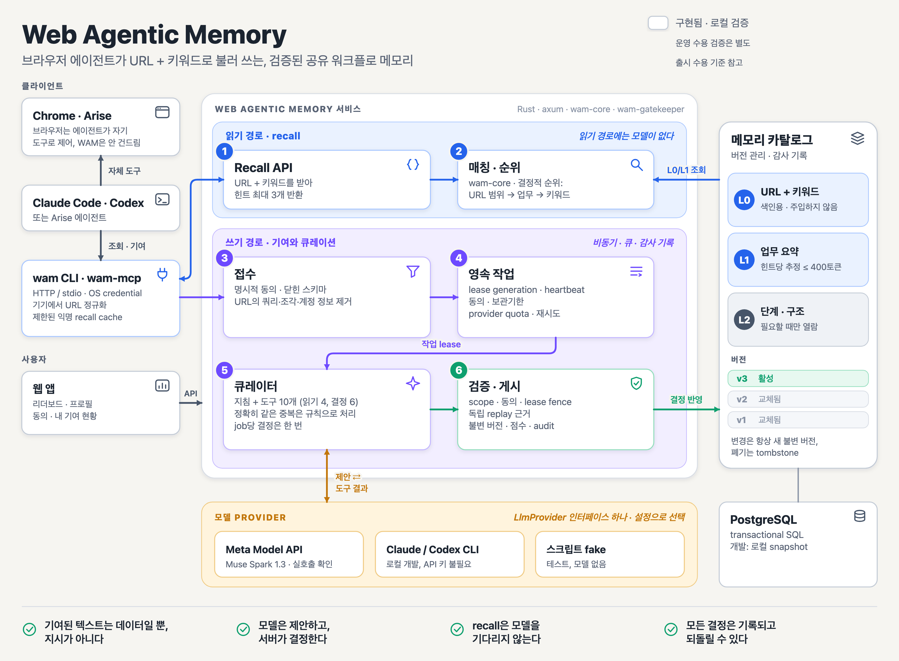

# Web Agentic Memory

[English](README.md) | 한국어

> 누군가 한 번 닦은 길은, 모든 에이전트가 따라갈 수 있어야 한다.

Web Agentic Memory(WAM)는 Codex·Claude Code 등 MCP 클라이언트에 연결하는 웹 작업용 공유 메모리다. 에이전트가 공개 URL과 작업에 맞는 짧고 검증된 힌트를 조회한 뒤, 이미 쓰던 브라우저 도구로 작업한다.

**공개 조회는 계정 없이 시작한다.** 기여·사용 영수증·공로 귀속에는 WAM 계정 연결이 필요하다. 메모리 MCP 연결만으로 백그라운드 조회나 브라우저 제어 도구 설치가 시작되지는 않는다.

## 시작하기

### 이미 운영 중인 WAM 서비스에 연결

서비스의 `/mcp` 주소를 사용한다. 아래 `https://wam.example/mcp`는 예시 주소이므로 실제 배포 주소로 바꾸고, 사용하는 호스트 하나를 선택한다.

| 호스트 | 원격 HTTP MCP 등록 | 등록 확인 |
|---|---|---|
| Codex | `codex mcp add web-memory --url https://wam.example/mcp` | `codex mcp get web-memory --json` |
| Claude Code | `claude mcp add --transport http --scope user web-memory https://wam.example/mcp` | `claude mcp get web-memory` |

에이전트에게 `web_memory_status` 호출을 요청한 뒤 현재 공개 사이트와 작업에 맞는 힌트를 조회한다. 등록 성공, 실제 도구 호출, 계정 인증은 각각 확인해야 한다. 웹의 `/guide`에서 호스트 선택부터 첫 조회, 선택적 계정 연결과 해제까지 안내한다.

원격 계정 기능은 서비스가 OAuth를 설정한 경우 호스트의 인증 흐름을 사용한다. 로컬 stdio는 `wam link`의 기기 승인과 OS 보안 저장소를 사용한다. 브라우저·사이트 로그인은 WAM 인증과 별개다. [계정·호스트 검증](docs/test/cli-link.md), [원격 OAuth 설정](docs/test/remote-oauth.md)을 참고한다.

### 이 저장소에서 직접 실행

Rust와 Cargo를 설치한 뒤 두 로컬 도구를 설치한다.

```sh
git clone https://github.com/heycodingkr/web-agentic-memory.git
cd web-agentic-memory
cargo install --path crates/wam-cli --locked
cargo install --path crates/wam-mcp --locked
wam --version
```

Cargo의 bin 디렉터리를 PATH에 추가한다. Linux 빌드는 D-Bus 개발 패키지(Debian/Ubuntu의 `libdbus-1-dev`, `pkg-config`)를 사용한다. 연결된 자격증명은 macOS Keychain, Windows Credential Manager, Linux Secret Service에 저장하며 평문 파일 fallback은 없다. 보안 저장소가 없는 headless Linux에서도 공개 익명 조회는 가능하다.

별도 터미널에서 개발 API를 계속 실행한다.

```sh
cargo run -p wam-server --locked
```

기본 주소는 `http://127.0.0.1:3000`, 로컬 데이터는 `.wam-data/`다. 공개 조회에는 개발용 토큰이 필요 없다. 다음 명령으로 서비스 상태와 기본 예시를 확인한다.

```sh
wam --endpoint http://127.0.0.1:3000 --anonymous status --json
wam --endpoint http://127.0.0.1:3000 --anonymous recall https://example.com/guide/editor --task compose-draft --keyword blog --json
```

설치한 `wam-mcp`를 에이전트에서 쓰려면 로컬 등록 명령 하나를 선택한다.

| 전송 | Codex | Claude Code |
|---|---|---|
| Local stdio | `wam --endpoint http://127.0.0.1:3000 install codex --local` | `wam --endpoint http://127.0.0.1:3000 install claude-code --local --scope user` |

`wam --endpoint`에는 API 기본 주소를, 호스트의 원격 등록에는 `/mcp` 주소를 사용한다. `wam install`의 기본값은 원격 HTTP이며 **`--local`을 넣어야 stdio가 선택된다.** `--dry-run --json`을 추가하면 호스트 설정을 바꾸지 않고 등록 계획을 볼 수 있다. 도우미가 `wam` 옆의 `wam-mcp`를 찾을 수 있도록 두 바이너리를 함께 설치한다.

`wam guide print --host codex` 또는 `wam guide print --host claude-code`로 조회 시점에 관한 지시문을 출력한다. `--write`를 추가할 때만 현재 프로젝트의 `AGENTS.md` 또는 `CLAUDE.md`를 수정한다. 사용자가 메모리를 쓰지 말라고 하면 그 지시를 따른다. 상세 정보가 필요할 때는 recall에서 받은 버전 ID로 `wam expand <id> --version-id <version-id> --level 2 --json`을 호출한다.

웹 앱은 CI에 지정한 Node 22와 pnpm 10을 기준으로 실행한다.

```sh
pnpm --dir web install --frozen-lockfile
pnpm --dir web dev
```

`http://localhost:5173`에서 랜딩·랭킹·설치 가이드를 확인한다. Vite가 API/MCP 요청을 로컬 서버로 전달한다. API origin, GitHub OAuth, 운영 저장소와 신뢰할 재현 실행기는 [웹 실행법](web/README.md), [서버 설정](crates/wam-server/README.md)을 참고한다. 계정 연결에는 인증 설정이 필요하며 공개 조회에는 필수가 아니다.

### 연결 제거

사용한 호스트에 맞춰 `wam uninstall codex` 또는 `wam uninstall claude-code --scope user`로 `web-memory` 등록을 지운다. 다른 호스트와 공유 자격증명·캐시는 유지된다. 로컬 기기 해지는 `wam unlink`, 파생 힌트 삭제는 `wam cache clear`를 사용하며 연결할 때와 같은 endpoint/config namespace를 사용한다. 원격 OAuth는 웹의 연결된 기기 화면에서 해지한다. 소스 설치 바이너리는 `cargo uninstall wam-cli`, `cargo uninstall wam-mcp`로 제거한다.

## 구현 상태

| 영역 | 현재 동작 |
|---|---|
| 공개 메모리 조회 | URL·작업·키워드 recall, 최대 3개 힌트, 버전 지정 상세 조회, 상태와 공개 랭킹 |
| MCP | stdio와 stateless Streamable HTTP가 같은 메모리 도구 10개를 제공. GET/POST SSE와 endpoint·인증·동의·catalog 상태 조회 |
| 계정 | 기기 연결, OS 자격증명 저장, 호스트 등록, 원격 OAuth discovery/DCR/PKCE·refresh·해지 |
| 기여·공로 | 명시적 공유 동의, Gatekeeper·신뢰할 재현 검증, immutable 게시, 조건을 충족한 작성자 +20·명시적 성공 사용 +2, 철회·reversal |
| 저장소·개인정보 | 트랜잭션 PostgreSQL 또는 잠긴 로컬 snapshot, 본인 usage·영향 통계, 익명 공유 cache, rate limit, 보관기한·계정 삭제 |
| 브라우저 연동 | 기존 브라우저 MCP와 WAM을 함께 사용. 선택형 지속 Arise 연결에서 소유 탭 recall을 명시적으로 호출 |

macOS 보안 저장소, 격리된 Codex/Claude 등록, 합성 OAuth 흐름, native Arise 소유 탭 recall, PostgreSQL/Redis 통합, 웹·CLI·MCP 회귀를 로컬에서 검증했다. 실계정 GitHub 여정, Claude/Arise Hub 원격 OAuth, 다른 OS runtime, 실제 서명 artifact 설치, 운영 부하·출시 증거는 별도 게이트다. [출시 수용 기준](docs/test/release-readiness.md)을 참고한다.

### 브라우저와 데이터의 경계

WAM은 힌트를 제공하고, 페이지 이동·클릭·입력은 브라우저 MCP가 맡는다. Chrome에서는 선택한 브라우저 연결 도구를 그대로 사용한다. Arise는 MCP Hub 설정이나 선택형 `wam browser-mcp` 연결을 [호스트 문서](docs/test/hosts/arise.md)에서 안내한다. 이 연결은 browser MCP 프로세스 하나를 유지하며 선택된 소유 lease를 확인하고 URL을 로컬에서 정규화한 뒤, 에이전트가 도구를 호출할 때만 조회한다. WAM이 Arise 내부 제어 socket에 직접 연결하지는 않는다.

WAM 요청에는 정규화된 공개 URL 패턴, 작업 코드, 허용된 키워드·동작을 사용한다. WAM의 조회·기여 요청에는 페이지 본문과 자유 입력 프롬프트를 포함하지 않는다. 브라우저·모델 서비스가 처리하는 정보는 각 서비스 설정을 따른다. 원격 호스트는 WAM에 요청하기 전에 도구 인자를 모델에 보여줄 수 있으므로 서버의 정규화를 기기 전체의 개인정보 보장으로 해석하면 안 된다.

조회당 **최대 3개, 힌트당 최대 400 추정 토큰**이다. 응답 메타데이터와 상세 조회는 별도다. 힌트는 참고자료이며 현재 화면과 사용자 지시를 확인하고 적용한다. 기여는 동의가 있을 때만 제출한다. 성공 사용 점수에는 본인 인증 영수증과 실제 사용한 버전 ID가 필요하며 익명·cache 힌트만으로는 점수를 만들지 않는다.

## 데모

[웹 앱](web/README.md)을 실행해 `/`의 영문 랜딩이나 `/ko`의 한국어 랜딩에서 연결 방법과 구체적인 힌트 예시를 확인한다. 아래 영상은 **로컬 데모 에디터의 스크립트 리플레이**이며 현재 WAM MCP를 통해 모델이 실제 작업을 완료한 기록은 아니다.

| 영상 | English | 한국어 |
|---|---|---|
| 같은 블로그 작업 비교 | [Watch](web/static/media/demo-compare.mp4) | [보기](web/static/media/demo-compare-ko.mp4) |
| 블로그 초안 | [Watch](web/static/media/demo-blog.mp4) | [보기](web/static/media/demo-blog-ko.mp4) |
| 슬라이드 에디터 | [Watch](web/static/media/demo-slides.mp4) | [보기](web/static/media/demo-slides-ko.mp4) |

## 현재 증거

증거 등급은 **C**(조건당 단일 관찰, 참고용)다. 아래 수치는 이전 메모리 힌트 파일럿이며 현재 WAM MCP 전체나 모든 호스트의 end-to-end 벤치마크는 아니다. 슬라이드 작업은 아직 벤치마크하지 않았다. 로컬 테스트는 특정 계약과 fixture를 확인하며 일반적인 속도·토큰 절감 보장을 뜻하지 않는다.

2026-10-16 파일럿 측정. 같은 태스크를 메모리 없이(tools only) 하는 경우와 메모리를 주입한 경우로 비교했다.
모델: Codex `gpt-6-luna`, effort `max`. 조건마다 새 격리 환경에서 실행했다.
상세 방법과 원자료: [평가 원자료](reference/agent-browser/docs/specs/browser-agent-memory-evaluation.md).

### 실제 사이트 (로그인된 실사용 에디터, 발행 없이 초안만 저장)

| 사이트 | 메모리 | 시간 | 툴 호출 | 시간 변화 | 호출 변화 |
|---|---|---:|---:|---:|---:|
| Medium | 없음 | 85.5초 | 10 | | |
| Medium | 주입 | **44.3초** | **7** | **−48%** | **−30%** |
| Naver Blog | 없음 | 84.1초 | 16 | | |
| Naver Blog | 주입 | **58.8초** | **12** | **−30%** | **−25%** |

품질 변화도 있었다. Medium은 메모리 없이 했을 때 불필요한 빈 문단이 하나 생겼지만, 주입 후에는 제목과 정확히 두 문단만 저장됐다. (새 브라우저 세션에서 편집 URL을 다시 열어 확인)

### 통제된 에디터 fixture (독립 저장 oracle로 결과 검증)

| 에디터 | 메모리 | 시간 | 툴 호출 | 오류 | 시간 변화 |
|---|---|---:|---:|---:|---:|
| 리치 에디터 | 없음 | 130.3초 | 16 | 0 | |
| 리치 에디터 | 수동 recall | 66.7초 | 12 | 0 | −49% |
| 리치 에디터 | 자동 주입 | **55.2초** | **11** | 0 | **−58%** |
| iframe 에디터 | 없음 | 195.4초 | 28 | 3 | |
| iframe 에디터 | 수동 recall | **91.7초** | 18 | 0 | **−53%** |
| iframe 에디터 | 자동 주입 | 130.9초 | 17 | 0 | −33% |

### 요약

| 지표 | 개선 범위 | 4개 조건 단순 평균 |
|---|---|---|
| 소요 시간 | −30% ~ −58% | 약 −42% |
| 툴 호출 수 | −25% ~ −39% | 약 −31% |
| 오류 | iframe에서 3 → 0 | |

### 정직하게 밝혀둘 한계

- 조건당 **1회 시행**이고 실행 순서도 무작위가 아니다. 일반적인 지연 보장이 아니라 **파일럿 관찰**이다.
- Naver 실사이트는 두 번째 실행에서 이어쓰기 팝업과 임시저장 개수가 달라져, 통제된 A/B가 아니다.
- iframe fixture에서는 자동 주입이 수동 recall보다 느렸다. 자동 주입이 항상 가장 빠른 것은 아니다.
- 서버가 503을 반환하는 등 사이트 자체 문제는 메모리로 해결되지 않는다. 이 경우 에이전트가 실패를 정확히 보고하는 것까지 확인했다.
- **TODO:** 조건별 3~5회 반복 측정으로 평균과 편차를 보고한다. 호스트(Arise 자체 메모리 자동 주입 vs Chrome MCP + WAM 수동 recall)별로 분리해서 측정한다.

## 구조와 개발



```text
에이전트와 기존 브라우저 도구
   | MCP 또는 CLI: 공개 URL 패턴 + 작업 + 허용 키워드
   v
Web Agentic Memory 서버 (Rust)
   ├─ 사이트별 승인된 워크플로 카탈로그 ──▶ recall: 최대 3개, 각 ≤ 400 추정 토큰
   └─ 동의한 기여 ──▶ Gatekeeper + 신뢰할 재현 검증 ──▶ immutable 게시
```

Rust workspace는 `wam-core`, `wam-contracts`, `wam-client`, `wam-cli`, `wam-mcp`, `wam-server`, `wam-gatekeeper`로 나뉜다. 웹은 SvelteKit/TypeScript다. 공유 application store는 PostgreSQL, 공유 quota는 Redis를 사용하고 로컬 모드는 잠긴 snapshot과 in-memory limiter를 쓴다. 모델 provider와 신뢰할 브라우저 재현 실행기는 명시적인 인터페이스로 분리한다.

```sh
cargo test --workspace --locked
cargo clippy --workspace --all-targets --locked -- -D warnings
cargo fmt --all -- --check
pnpm --dir web test
pnpm --dir web check
pnpm --dir web build
```

검사는 로컬에서 실행하며 GitHub Actions 워크플로우는 포함하지 않는다.

DB·Redis·실제 provider·OS 보안 저장소 테스트에는 별도 환경이 필요하다. [테스트 인덱스](docs/test/README.md), [소유한 로컬 데이터 서비스 실행기](tests/env/README.md), [출시 검사](docs/test/release-readiness.md)에서 조건을 확인한다. Fixture 성공과 실제 호스트·계정 검증을 구분해 기록한다.

## 왜 길을 공유하는가

에이전트는 사이트마다 같은 사용법을 다시 찾고, 세션이 끝나면 그 비용을 다시 낸다. WAM은 한 번 검증한 발견이 다음 에이전트에게 도움이 되도록 하면서, 공유는 선택으로 남기고 기여자의 공로를 기록하려는 프로젝트다. 배경과 원문 자료는 [사상의 계보와 설계 원칙](docs/history.md)에 정리했다.

## 문서

| 문서 | 내용 |
|---|---|
| [CLI 안내](crates/wam-cli/README.md) · [MCP 안내](crates/wam-mcp/README.md) | 명령, 자격증명, 호스트 등록과 도구 계약 |
| [웹 실행법](web/README.md) · [서버 설정](crates/wam-server/README.md) | 로컬 개발과 서비스 구성 |
| [시스템 개요](docs/design/system-overview.ko.md) · [모듈 경계](docs/design/module-boundaries.md) | 구성요소, 데이터 흐름, 테스트 경계 |
| [브라우저·호스트 연동](docs/design/browser-host-integration.md) | 브라우저 소유권과 WAM 계정의 경계 |
| [요구사항](docs/spec/README.md) · [테스트 인덱스](docs/test/README.md) | 계약과 검증 절차 |
| [출시 수용 기준](docs/test/release-readiness.md) · [서명 archive 검증](docs/test/releases.md) | 증거 게이트와 다운로드 artifact의 안전한 설치 |
| [CONTRIBUTING.md](CONTRIBUTING.md) · [SECURITY.md](SECURITY.md) | 저장소 규칙과 데이터 취급 |
| [공개 준비 점검](docs/open-source-readiness.md) · [reference 안내](reference/README.md) | 라이선스·reference 권리·공개 범위 |

## 다음 단계

- [x] 공개 recall, MCP/CLI와 웹 설치 안내
- [x] 동의 기반 기여, 결정적 검사와 중복 처리
- [x] 트랜잭션 게시, 버전 귀속과 점수 원장
- [x] 로컬 통합·브라우저 fixture·회귀 검사
- [ ] 실제 모델 + WAM 작업 영상과 호스트별 반복 측정
- [ ] 실계정·다른 OS·실제 서명 artifact 수용 검증
- [ ] 운영 서비스·부하 증거와 공개 출시 결정

## 라이선스

아직 선택하지 않았다. LICENSE 파일이 추가되기 전까지 이 저장소의 재사용 권한은 부여되지 않는다. `reference/` 안의 파일은 별도 권리 검토가 필요하다. 소스 반영은 바이너리 릴리스의 수용 게이트 통과를 뜻하지 않는다.
