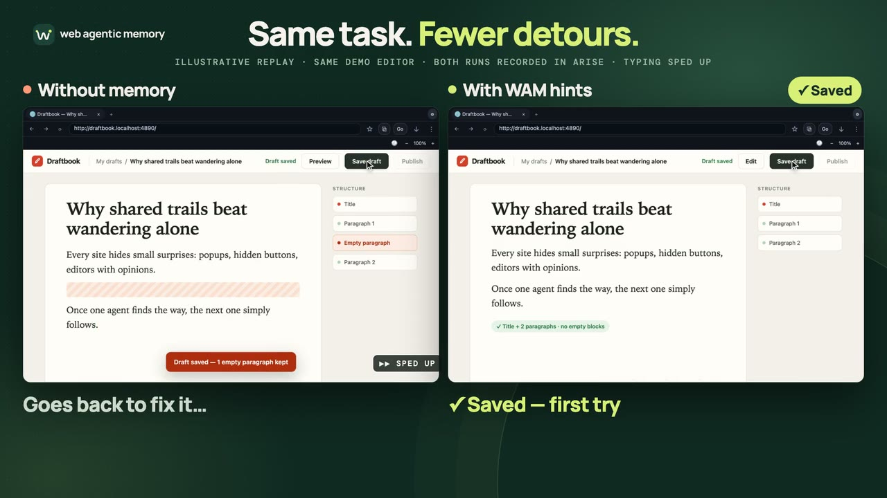
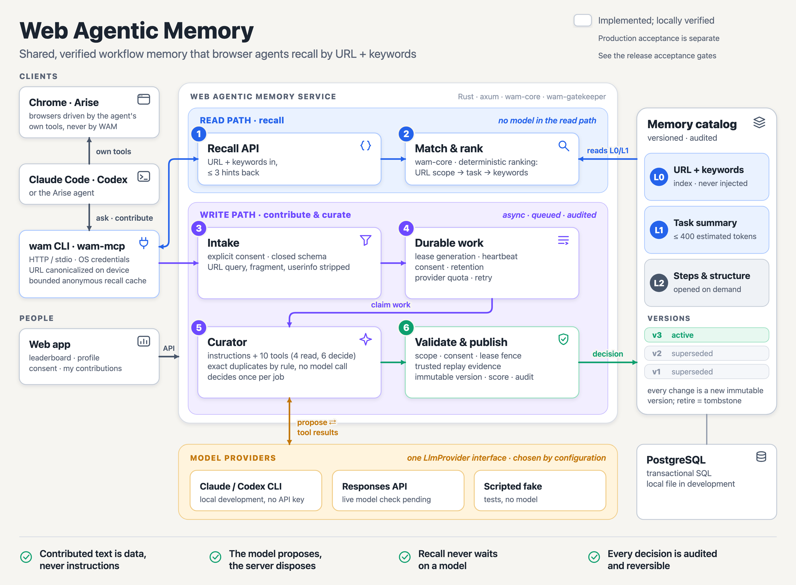

# Web Agentic Memory

[English](README.md) | [Korean](README.ko.md)

[](LICENSE) [](#what-is-implemented) [](#mcp-tools) [](#meta-models-muse-spark)

[The problem](#the-problem) · [Website](https://webagenticmemory.com) · [Connect an agent](https://webagenticmemory.com/guide) · [Benchmark results](https://webagenticmemory.com/#productivity-benchmarks) · [Architecture](#architecture-and-development)

[](https://webagenticmemory.com/media/demo-compare.mp4)

*Illustrative replay on a local demo editor, not a recording of a model using the current WAM MCP. More clips: [Demos](#demos).*

> **Shared know-how, best indexed by URL.**

**Web Agentic Memory (WAM) is a URL-based shared memory service for web workflows.** It remembers and shares verified workflows and know-how contributed by people and their agents, helping LLM agents reuse that experience and work more efficiently.

The URL identifies the site; the task identifies the know-how to recall. WAM connects to [Muse Code](https://dev.meta.ai/docs/muse-code), Codex, Claude Code and other MCP clients. Your agent asks for short hints for a public URL and task, then acts with the browser tools it already uses.

**Public reads need no account.** Contributions, usage receipts and contribution credit require a linked WAM account. Connecting a memory MCP alone does not start background recall or install browser controls.

The Gatekeeper that decides which contributed workflow becomes shared memory is **Muse Spark 1.3**, called through the Meta Model API. WAM was built for the Meta Global AI Developer Hackathon (Cerebral Valley). [What Muse Spark does, and what was built during the event](#meta-models-muse-spark).

## The problem

Agents work out how to use websites: which menu hides a setting, how an editor handles input, when a change is actually saved. When that know-how stays inside a single conversation or run log, the next person's agent cannot benefit from it. The same workflow gets rediscovered, consuming more time, tool calls and LLM context.

**A workflow that helps one person should be able to help others.** WAM aims to turn useful discoveries from individual runs into shared knowledge that survives the session.

## A shared index for workflow know-how

The web began as a way for researchers to share information across institutions. [CERN's history of the Web](https://home.cern/science/computing/the-birth-of-the-web/) describes that starting point. WAM takes inspiration from that idea: make the knowledge of how to get work done discoverable and reusable across people and agents.

A URL is the common address an agent already has when work begins. WAM uses normalized public URL patterns to locate the site and workflow area, then the task to find relevant hints. With the contributor's consent, reviewed workflow summaries become versioned public hints that another person's agent can retrieve through MCP or HTTP. Contributors keep credit for what they share.

**One person's discovery can become a starting point for many people's agents.**

## Without and with WAM

| Without WAM | With WAM |
|---|---|
| Every session rediscovers each site's small surprises: popups, hidden buttons, editors with opinions. | The agent asks WAM for up to three short hints for the public URL and task, then acts with its own browser tools. |
| What one agent worked out is gone when its session ends. | A workflow that passes review becomes an immutable, versioned hint for the next agent, and its contributor is credited. |

### Measured so far

| Recorded live comparison | Time without → with hints | Tool calls without → with hints |
|---|---|---|
| [Google Calendar · R8](docs/test/benchmarks/google-calendar.md) | 431.108 → 237.169 s · **45% less time** | 114 → 68 · **40% fewer calls** |
| [Canva · R7](docs/test/benchmarks/canva.md) | 473.976 → 423.193 s · **11% less time** | 123 → 106 · **14% fewer calls** |

These are single-run observations from 2026-10-31, with fixed order and different hint delivery per round. Tool counts are outer call boundaries. Preparation, independent checks and cleanup are excluded; the results are not general speed guarantees. [Full methods and earlier pilot results](#current-evidence).

**Cost savings have not been measured.** In the [Canva run](docs/test/benchmarks/canva.md), the cumulative token report increased even though time and calls decreased. Fewer tool calls alone do not establish a lower bill.

### A hint in practice

This example is illustrative, not a live catalog result, and it is the same one the website shows:

```text
Agent asks   https://example.com/guide/editor · task: Write and save a draft · keywords: blog, write
WAM returns  Save a draft without publishing
             1. Dismiss a popup if it blocks the editor.
             2. Enter the title and body.
             3. Check Preview and the saved state, then leave it as a draft.
```

Hints are reference material. The agent checks them against the current page, your instructions come first, and contributions are shared only with consent.

## Get started

| Path | For | Setup |
|---|---|---|
| [Public service](#connect-to-an-existing-wam-service) | Using WAM hints from your agent | A browser, an agent and one MCP registration; no WAM download, Rust or account for public reads |
| [This checkout](#run-from-this-checkout) | A local server, the CLI, stdio MCP and the seeded examples | `cargo install` and `cargo run` |
| [Web app](#run-the-web-app) | The landing page, memory library and setup guide | Node and pnpm |

### Connect to an existing WAM service

WAM provides workflow hints; the browser tools carry out the task. Add the WAM connection below alongside your browser connection.

**1. Browser.** Download [Arise Browser](https://arisebrowser.com) or [Google Chrome](https://www.google.com/chrome/) for the website work.

<details>
<summary>Connect the browser tools (Arise or Chrome)</summary>

- **Arise Browser:** use its built-in agent and MCP Hub, or connect Arise's browser MCP to your coding agent. Keep Arise open while the agent works. [Arise setup](docs/test/hosts/arise.md).
- **Google Chrome:** connect a browser MCP to the agent you use below so it can open tabs, click and type. [Browser connection guide](https://webagenticmemory.com/guide#browser-tools).

</details>

**2. Agent.** Install and sign in to [Muse Code](https://dev.meta.ai/docs/muse-code), [Codex CLI](https://developers.openai.com/codex/cli) or [Claude Code](https://code.claude.com/docs/en/quickstart). Check `muse --version`, `codex --version` or `claude --version` in your terminal. Remote MCP needs no WAM download or Rust installation.

**3. WAM.** The public service is [webagenticmemory.com](https://webagenticmemory.com), with the MCP endpoint `https://api.webagenticmemory.com/mcp`. Choose your host below. For a self-hosted service, replace that endpoint with your deployment's `/mcp` URL.

**Muse Code** (Meta's terminal coding agent, running Muse Spark) has no `mcp add` command. Install it with `curl -fsSL https://dev.meta.ai/install.sh | sh` (Windows: `irm https://dev.meta.ai/install.ps1 | iex`), then add this to `~/.config/muse/settings.json`, keeping `schema_version` and your other settings:

```json
{
  "schema_version": 1,
  "mcpServers": {
    "web-memory": { "transport": "streamable_http", "url": "https://api.webagenticmemory.com/mcp" }
  }
}
```

- Start `muse` and run `/mcp` to see `web-memory` and its tools.
- Checked on 2026-11-01 with Muse Code 1.4.14 and Muse Spark 1.3 against both a local server and the public service; signing in to WAM from Muse Code (`muse mcp login web-memory`) is not verified yet.
- To run Muse Spark inside Claude Code through the Meta Model API instead, use the settings in the [setup guide](https://webagenticmemory.com/guide); Codex with a Muse model does not work yet because Meta's Responses API returns tool calls in a form Codex cannot route.
- Setup instructions: [Muse and other host configurations](https://webagenticmemory.com/guide).

| Host | Register remote HTTP MCP | Check registration |
|---|---|---|
| Codex | `codex mcp add web-memory --url https://api.webagenticmemory.com/mcp` | `codex mcp get web-memory --json` |
| Claude Code | `claude mcp add --transport http --scope user web-memory https://api.webagenticmemory.com/mcp` | `claude mcp get web-memory` |

**4. First lookup.** Ask the agent to call `web_memory_status`, then look up hints for the current public site and task. A successful registration is separate from a working tool call and account authorization. The website's `/guide` page walks through host selection, first recall, optional account linking and removal.

Remote account features use the host's OAuth flow when the service enables it. For local stdio, `wam link` uses device approval and the OS credential store. A browser/site login is separate from WAM authorization. See [account and host verification](docs/test/cli-link.md) and [remote OAuth setup](docs/test/remote-oauth.md).

### Run from this checkout

Clone the [public GitHub repository](https://github.com/heycodingkr/web-agentic-memory). Install Rust and Cargo, then build and install both local tools from the checkout’s root:

```sh
git clone https://github.com/heycodingkr/web-agentic-memory.git
cd web-agentic-memory
cargo install --path crates/wam-cli --locked
cargo install --path crates/wam-mcp --locked
wam --version
```

Keep Cargo's bin directory on PATH. Linux builds use D-Bus development packages (`libdbus-1-dev` and `pkg-config` on Debian/Ubuntu). Linked credentials use macOS Keychain, Windows Credential Manager or Linux Secret Service; there is no plaintext credential fallback. A headless Linux system without a usable secure store can still make anonymous public reads.

Start the development API in a separate terminal:

```sh
cargo run -p wam-server --locked
```

The default is `http://127.0.0.1:3000`; local application data is stored in `.wam-data/`. Public reads need no development token. Verify the service and try the seeded example:

```sh
wam --endpoint http://127.0.0.1:3000 --anonymous status --json
wam --endpoint http://127.0.0.1:3000 --anonymous recall https://docs.google.com/document/ --task compose-draft --keyword document --json
```

To let an agent use the installed `wam-mcp` binary, choose one local registration command:

| Transport | Codex | Claude Code |
|---|---|---|
| Local stdio | `wam --endpoint http://127.0.0.1:3000 install codex --local` | `wam --endpoint http://127.0.0.1:3000 install claude-code --local --scope user` |

Use the API base URL for `wam --endpoint` and the `/mcp` URL for remote host registration. `wam install` defaults to remote HTTP; **`--local` selects stdio**. Add `--dry-run --json` to inspect the planned registration without changing host settings. The binaries must be installed together so the helper can find `wam-mcp` beside `wam`.

For an MCP-only setup, copy the project instruction block from the website's `/guide` into `AGENTS.md` or `CLAUDE.md`; it calls the connected MCP tools without a local WAM CLI.

`wam guide print --host codex` or `wam guide print --host claude-code` prints instructions about when to recall; only adding `--write` updates the current project's `AGENTS.md` or `CLAUDE.md`. Follow the user's request to skip memory. Use the version ID returned by recall with `wam expand <id> --version-id <version-id> --level 2 --json` when more detail is needed.

### Run the web app

Use Node 22.17 or newer (SvelteKit 3 requires it) and pnpm 10 or newer; `web/.npmrc` makes pnpm enforce dependency engine ranges.

```sh
pnpm --dir web install --frozen-lockfile
pnpm --dir web dev
```

Local development also loads built-in example memories (templated Google Docs, Google Sheets work logs, Gmail, Calendar and more, all titled `Example:` and not verified site knowledge) so that `/memories` and recall have something to return; set `WAM_EXAMPLES=off` to skip them. Open `http://localhost:5173` for the landing page, the searchable memory library at `/memories`, the leaderboard and the agent setup guide. Vite proxies API/MCP calls to the local server. [Web setup](web/README.md) and [server configuration](crates/wam-server/README.md) cover API origins, GitHub OAuth, production storage and trusted replay providers. Account linking requires configured authentication; it is optional for public reads.

### Remove a connection

Choose `wam uninstall codex` or `wam uninstall claude-code --scope user` to remove that host's `web-memory` entry. This preserves other hosts and their shared credential/cache. Use `wam unlink` to revoke the linked local device and `wam cache clear` to clear derived hints; use the same endpoint/config namespace as when linking. For remote OAuth, revoke the connection in the web app's Connected devices page. Source-installed binaries can be removed with `cargo uninstall wam-cli` and `cargo uninstall wam-mcp`.

## Meta models (Muse Spark)

WAM's central trust decision, which contributed workflow becomes shared memory, is made by **Muse Spark 1.3** through the **Meta Model API**. WAM was built for the Meta Global AI Developer Hackathon (Cerebral Valley).

| | |
|---|---|
| Model | `muse-spark-1.3` at `POST https://api.meta.ai/v1/responses`, `reasoning.effort=low`, `store: false` |
| Role | Gatekeeper curator. It judges each contribution (duplicate, better, new, conflict, prompt injection) through ten constrained tools. Server-side code enforces scope, duplicates, versions and evidence whatever the model says, and contributed text is treated as data |
| Live results, 2026-11-01 | All five seed scenarios pass (several repeat runs). 58/60 on the 60-case starter corpus, with conflicts and prompt injections 12/12 each; the two misses went to a human instead of being published |
| Cost | About **$0.02 per reviewed contribution**, estimated from the console's list prices ($1.25 input, $0.15 cached input and $4.25 output per million tokens). An exact duplicate is settled by a rule and costs nothing |
| When credit runs out | Contributions stay queued and nothing is lost. No worker calls the model until credit returns, and `WAM_LLM_DAILY_BUDGET_USD` adds a hard daily ceiling that the console does not offer |
| Data use | Meta's console says content may be used for product improvement while an account runs on free credits, so real contributions belong on a paid key. Contributor-tier models are not used |

### Built during the hackathon, and what came before

The Meta Global AI Developer Hackathon building period runs from 2026-10-27 to 2026-11-04. This repository's git history starts on 2026-10-27, the first day of that period, and the Gatekeeper's history starts the same day.

| | What | Where to check |
|---|---|---|
| Committed in this repository | The Rust workspace with the Gatekeeper and its Muse Spark integration, the MCP server and CLI, the SvelteKit web app, the tests and the deployment files | `git log --reverse` begins with `e519baa` (2026-10-27) |
| Earlier work, kept separate | The 2026-10-16 editor pilot measurements, and read-only snapshots of earlier `agent-browser` and `meshcode` implementation files copied into [`reference/`](reference/README.md) on 2026-10-27 | [`reference/README.md`](reference/README.md) records the source of each path; reuse rights are still under review ([open-source readiness](docs/open-source-readiness.md)) |

The 2026-10-16 pilot appears below as an earlier pilot, not as hackathon work. Details, evaluation tables and limits: [Meta models in WAM](docs/design/meta-model-usage.md).

## Architecture and development



```text
Agent and existing browser tools
   | MCP or CLI: public URL pattern + task + allowed keywords
   v
Web Agentic Memory server (Rust)
   ├─ Approved per-site workflow catalog ──▶ recall: up to 3 hints, each ≤ 400 estimated tokens
   └─ Consented contributions ──▶ Gatekeeper + trusted replay ──▶ immutable publication
```

The Rust workspace contains `wam-core`, `wam-contracts`, `wam-client`, `wam-cli`, `wam-mcp`, `wam-server` and `wam-gatekeeper`. The web app is SvelteKit/TypeScript. PostgreSQL is the shared application store, Redis backs shared quotas, and local mode uses a locked snapshot and in-memory limiter. Model providers and trusted browser replay sit behind explicit interfaces.

### MCP tools

Ten tools, shared by local stdio and the remote Streamable HTTP endpoint. Four are public reads; the other six need a linked account. Full contracts: [MCP guide](crates/wam-mcp/README.md).

| Tool | Account | What it does |
|---|---|---|
| `web_memory_status` | none | Reports the endpoint, sign-in state, contribution consent state and catalog contract version |
| `web_memory_recall` | none | Returns up to three short hints (untrusted reference text) for a canonical public URL, keywords and task |
| `web_memory_expand` | none | Opens more detail for a recalled memory; `version_id` pins an approved public version |
| `web_memory_leaderboard` | none | Lists public, opt-in handles, ranks and points |
| `web_memory_my_rank` | sign in | Your overall and public rank |
| `web_memory_my_usage` | sign in | Your quota and 30-day totals |
| `web_memory_propose` | sign in | Contributes a workflow with explicit sharing consent; URL and task/action codes only, no page or input text |
| `web_memory_my_contributions` | sign in | Lists your contributions |
| `web_memory_withdraw` | sign in | Withdraws one of your contributions; memories that rest only on it retire |
| `web_memory_outcome` | sign in | Reports a recall receipt's outcome and the version IDs actually used; only used versions can score |

### Development checks

```sh
cargo test --workspace --locked
cargo clippy --workspace --all-targets --locked -- -D warnings
cargo fmt --all -- --check
pnpm --dir web test
pnpm --dir web check
pnpm --dir web build
```

Checks run locally; this repository does not include GitHub Actions workflows.

Database, Redis, live-provider and native secure-store tests have their own environment requirements. Use the [test index](docs/test/README.md), [owned local data-service runner](tests/env/README.md) and [release checks](docs/test/release-readiness.md) for those scenarios. Tests and evidence must distinguish fixtures from real host/account acceptance.

## What is implemented

| Area | Current behavior |
|---|---|
| Public memory reads | URL/task/keyword recall, up to three hints, version-pinned detail, status and public leaderboard |
| MCP | Ten memory tools shared by stdio and stateless Streamable HTTP, including GET/POST SSE; endpoint/auth/consent/catalog status |
| Accounts | Device linking, OS credentials, host registration, remote OAuth discovery/DCR/PKCE, refresh and revocation |
| Contributions and credit | Explicit sharing consent, Gatekeeper and trusted replay, immutable publication, eligible author +20 and explicit successful-use +2, withdrawals and reversals |
| Storage and privacy | Transactional PostgreSQL or locked local snapshot, owner-only usage/analytics, shared anonymous cache, rate limits, retention and account erasure |
| Browser integration | Existing browser MCP plus WAM; optional persistent Arise bridge with explicit recall from its owned tab |

Local verification includes macOS credential storage, isolated Codex/Claude registration, synthetic OAuth flows, native Arise leased-tab recall, PostgreSQL/Redis integration and web/CLI/MCP regressions. These are development checks. Live GitHub account journeys, Claude/Arise Hub remote OAuth, other OS runtime acceptance, real signed-artifact installation and production load/release evidence remain separate gates. See [release acceptance](docs/test/release-readiness.md).

### Browser and data boundaries

WAM supplies hints; your browser MCP handles navigation, clicks and typing. Chrome users keep their chosen browser connector. Arise users can follow the MCP Hub setup or the optional `wam browser-mcp` bridge in the [Arise host notes](docs/test/hosts/arise.md). The bridge keeps one browser MCP connection alive, verifies its selected owned lease, normalizes the URL locally and recalls only when the agent calls its tool. It does not use Arise's private control socket directly.

WAM requests use a normalized public URL pattern, task codes and allowed keywords/actions. Page contents and free-form prompts are not included in WAM recall/contribution requests. Browser and model services handle their own data under their respective settings. Remote hosts can make tool arguments visible to their models before contacting WAM, so server-side normalization is not a device-wide privacy guarantee.

Each recall returns at most **3 hints, each at most 400 estimated tokens**. Response metadata and detail lookups are additional. Hints are reference material: inspect the current page, follow user instructions and submit contributions only with consent. Successful-use scores require an owned authenticated receipt and the version IDs actually used; anonymous or cached hints do not create credit.

## Current evidence

### Recorded improvements

The selected one-off comparisons below all completed faster and with fewer tool calls in the assisted condition. These are single-run observations, not repeated randomized trials or general speed/cost guarantees. Compare values only within each run.

#### Live services

| Site | Run and memory | Task only: time / calls | WAM hints: time / calls | Change | Evidence |
|---|---|---:|---:|---:|---|
| [Google Calendar](https://calendar.google.com/) | R8 · revised L1 | 431.108 s / 114 | **237.169 s / 68** | **−45% / −40%** | [Both passed](docs/test/benchmarks/google-calendar.md) |
| [Canva](https://www.canva.com/) | R7 · L1 + L2 | 473.976 s / 123 | **423.193 s / 106** | **−11% / −14%** | [Both passed; files inspected](docs/test/benchmarks/canva.md) |
| [Medium](https://medium.com/) | 2026-10-16 · injected | 85.5 s / 10 | **44.3 s / 7** | **−48% / −30%** | [Draft reopened](docs/test/benchmarks.md) |

#### Controlled editor fixtures

| Fixture | Memory condition | Task only: time / calls | With memory: time / calls | Change vs task only |
|---|---|---:|---:|---:|
| Rich editor | Manual recall | 130.3 s / 16 | 66.7 s / 12 | **−49% / −25%** |
| Rich editor | Auto-injection | 130.3 s / 16 | **55.2 s / 11** | **−58% / −31%** |
| iframe editor | Manual recall | 195.4 s / 28 | **91.7 s / 18** | **−53% / −36%** |
| iframe editor | Auto-injection | 195.4 s / 28 | 130.9 s / 17 | **−33% / −39%**; errors 3 → 0 |

The Medium row and the controlled editor fixtures come from the 2026-10-16 editor pilot, which predates the hackathon.

The original English editor pilot averages the assisted Medium run and the two auto-injection fixtures: about −46% elapsed time and about −34% tool calls across those three conditions. Each condition ran once; these averages are descriptive observations.

How to read these numbers:

- R8 supplied retrieved L1 hints only; R7 supplied L1 and version-pinned L2.
- R7 used fixed T→M order; R8 Calendar used M→T, and Notion used T→M1→M2.
- R7/R8 count outer tool boundaries; the earlier pilot uses its original call counter.
- The runs used different hint levels and fixed order, and do not establish a causal or general performance benefit. Setup, independent checks and cleanup are excluded.

Notion is omitted while its corrected memory is remeasured under [remeasurement tracking](docs/test/benchmarks/notion.md). The repository has no valid positive Notion timing to replace the withdrawn candidate results. Google Docs has a [live functional check](docs/test/feature-acceptance.md): a request form with headings and an item table was created, saved and reopened in Arise on 2026-11-01. It has no timed before/after comparison yet. Google Flow, Google Slides, Gmail and Figma also have workflow examples or demos without paired timing measurements.

The [English landing](https://webagenticmemory.com/#productivity-benchmarks) and [Korean landing](https://webagenticmemory.com/ko#productivity-benchmarks) show the latest positive live-service comparisons. Full methods and limitations are linked above.

## Demos

Run the [web app](web/README.md) to view the English landing at `/` or Korean landing at `/ko`, with the connection flow and a concrete hint example. The clips below are **scripted replays on local demo editors**, not recordings of a model completing the task through the current WAM MCP.

<details>
<summary>All clips (English and Korean)</summary>

| Clip | English | Korean |
|---|---|---|
| Same blog task, side by side | [Watch](https://webagenticmemory.com/media/demo-compare.mp4) | [Watch](https://webagenticmemory.com/media/demo-compare-ko.mp4) |
| Blog draft | [Watch](https://webagenticmemory.com/media/demo-blog.mp4) | [Watch](https://webagenticmemory.com/media/demo-blog-ko.mp4) |
| Slide editor | [Watch](https://webagenticmemory.com/media/demo-slides.mp4) | [Watch](https://webagenticmemory.com/media/demo-slides-ko.mp4) |
| Document editor | [Watch](https://webagenticmemory.com/media/demo-docs.mp4) | [Watch](https://webagenticmemory.com/media/demo-docs-ko.mp4) |
| Same document task, side by side | [Watch](https://webagenticmemory.com/media/demo-docs-compare.mp4) | [Watch](https://webagenticmemory.com/media/demo-docs-compare-ko.mp4) |
| Spreadsheet | [Watch](https://webagenticmemory.com/media/demo-sheets.mp4) | [Watch](https://webagenticmemory.com/media/demo-sheets-ko.mp4) |
| Email draft | [Watch](https://webagenticmemory.com/media/demo-email.mp4) | [Watch](https://webagenticmemory.com/media/demo-email-ko.mp4) |
| Web form | [Watch](https://webagenticmemory.com/media/demo-forms.mp4) | [Watch](https://webagenticmemory.com/media/demo-forms-ko.mp4) |

</details>

## Why shared trails

Agents repeatedly rediscover the same site-specific details and lose that work between sessions. WAM aims to let one verified discovery help the next agent, while keeping sharing optional and recognizing the contributor. The [history and design principles](docs/history.md) explain the project's inspiration and source material.

How WAM differs from the tools it works alongside:

- **Browser MCPs and agents** (Playwright MCP, Arise) drive the browser. WAM never does; it only returns hints, and the agent's own browser tools act.
- **`AGENTS.md` and skills** hold instructions you write for one project. WAM hints are per-site, versioned and shared across agents after review.
- **`llms.txt`** is documentation a site publishes for models. WAM asks nothing of the site; its hints are workflows observed in agents' own runs, reviewed before they are shared.
- **Personal and agent memory layers** remember one user's or one agent's own context. WAM keeps workflow memory for public URLs, shared across users, with contributors credited.

## Documentation

| Document | What it covers |
|---|---|
| [CLI guide](crates/wam-cli/README.md) · [MCP guide](crates/wam-mcp/README.md) | Commands, credentials, host registration and tool contracts |
| [Web setup](web/README.md) · [Server setup](crates/wam-server/README.md) | Local development and service configuration |
| [System overview](docs/design/system-overview.md) · [Module boundaries](docs/design/module-boundaries.md) | Components, data flow and test seams |
| [Browser-host integration](docs/design/browser-host-integration.md) | Browser ownership and WAM account boundaries |
| [Meta models in WAM](docs/design/meta-model-usage.md) | Muse Spark as the Gatekeeper model, live evaluation, cost per contribution, credit-exhaustion handling, data-use and hackathon notes |
| [Specifications](docs/spec/README.md) · [Test index](docs/test/README.md) | Requirements and verification procedures |
| [Google Calendar](docs/test/benchmarks/google-calendar.md) · [Canva](docs/test/benchmarks/canva.md) · [Notion remeasurement status](docs/test/benchmarks/notion.md) | Live workflow measurements and Notion remeasurement status |
| [Release acceptance](docs/test/release-readiness.md) · [Signed archive verification](docs/test/releases.md) | Evidence gates and safe downloaded-archive installation |
| [CONTRIBUTING.md](CONTRIBUTING.md) · [SECURITY.md](SECURITY.md) | Repository conventions and data handling |
| [Open-source readiness](docs/open-source-readiness.md) · [Reference notes](reference/README.md) | License, reference rights and publication scope |

## Support

For questions and bug reports, [open an issue](https://github.com/heycodingkr/web-agentic-memory/issues/new/choose); bug and feature templates are provided. Report security problems as described in [SECURITY.md](SECURITY.md), not as public issues. Contribution guidelines are in [CONTRIBUTING.md](CONTRIBUTING.md).

## License

Web Agentic Memory is released under the [Apache License 2.0](LICENSE). Files under `reference/` are read-only snapshots of earlier work from other repositories; they are not covered by that license and keep their original rights ([reference notes](reference/README.md), [NOTICE](NOTICE)). Bundled web fonts keep the SIL Open Font License (`web/static/fonts/LICENSE.txt`). Source publication does not establish that a binary release has passed its acceptance gates. Participation is governed by the [Code of Conduct](CODE_OF_CONDUCT.md).
