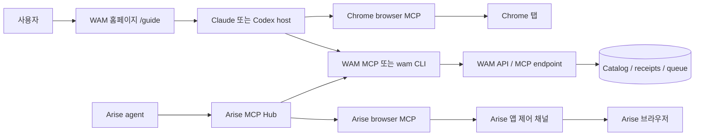

# 브라우저 호스트 연동 결정 기록과 구현 전 검증 명세

상태: 구현 전에 검토할 설계 결정 초안. 제품 MCP/CLI와 호스트 연동은 아직 릴리스 검증을 마치지 않았다. 기능 요구사항의 단일 출처는 `docs/spec/`, 실행 절차와 판정의 단일 출처는 `docs/test/`이며, 이 문서는 두 경계를 잇는 맥락·결정·구현 순서를 기록한다.
기록일: 2026-10-27

2026-10-29 구현 갱신: 선택형 `wam browser-mcp`가 공개 Arise stdio MCP child를 지속 연결해 browser 도구와 `web_memory_recall_current_tab`을 같은 entry로 제공한다. 실제 소유 lease·target 재확인·로컬 URL 정규화·recall은 macOS native browser MCP로 검증했다. Background 자동 recall과 Arise Hub remote OAuth/모델 행동 acceptance는 별도다. [구현 및 증거](../test/hosts/arise.md)가 현재 상태의 기준이다.

## 0. 결정 요약

1. WAM은 메모리 검색·상세 조회·동의한 기여·결과 영수증을 제공한다. Chrome 조작용 CDP 서버나 브라우저 자동화 도구를 기본 설치물로 제공하지 않는다.
2. Chrome 고객은 ChromeBridge/Chrome DevTools MCP 등 선택한 브라우저 connector와 WAM MCP 또는 CLI를 각자 연결한다. 브라우저 connector가 CDP를 쓰는 경우 그 연결과 권한은 connector가 소유한다.
3. Arise 고객은 Arise의 자체 브라우저 MCP와 외부 MCP 허브를 사용한다. WAM은 허브에 remote MCP 또는 local stdio MCP로 등록한다. Unix domain socket은 Arise 앱과 자체 브라우저 프로세스의 내부 통신이므로 WAM 통합 계약으로 쓰지 않는다.
4. 에이전트는 작업 전 URL 범위, task, 허용 키워드로 WAM recall을 호출하고 반환 힌트를 브라우저 도구로 수행한다. 메모리 호출만으로 브라우저 도구가 설치되거나 현재 탭을 읽게 되지는 않는다.
5. 원 URL/query가 기기 밖으로 나가지 않는다고 보장하려면 WAM 도구 호출 전에 로컬 CLI 또는 지원되는 host-native adapter에서 정규화해야 한다. 일반 원격 MCP에 모델이 만든 URL을 보내는 경로는 이 보장을 자동으로 충족하지 않는다.
6. WAM 로그인은 브라우저 로그인과 분리한다. 공개 읽기는 익명 허용, receipt·기여·점수는 명시적으로 연결된 WAM 계정과 동의에만 귀속한다.

## 1. 배경과 사용자 목표

일반 고객은 홈페이지의 `/guide`에서 자기 호스트용 WAM MCP 설정이나 CLI 설치 방법을 복사한다. Claude Code, Codex 같은 에이전트가 WAM의 승인된 메모리를 조회한 다음, 고객이 이미 연결한 브라우저 MCP로 웹 작업을 한다. 예를 들어 Naver 블로그 편집기 작업이면 현재 페이지 범위와 `naver`, `blog`, `write` 같은 제한된 키워드 및 `compose-draft` task로 기억을 찾고, 초안 작성·저장 순서에 관한 짧은 힌트를 따른다.

제품은 서로 다른 책임을 맡는 세 부분을 연결한다.

| 부분 | 책임 | 소유하는 권한 |
|---|---|---|
| WAM 웹·서버·MCP·CLI | 설치 가이드, URL/task/keyword recall, 승인 메모리, 계정 연결, 기여와 점수 | WAM 계정·기여 데이터·receipt |
| 브라우저 connector | Chrome 또는 Arise에서 탭 읽기와 웹 입력·탐색 수행 | 사용자가 허가한 브라우저 session과 사이트 데이터 |
| AI host | 브라우저 요청 의도에서 task/keyword 추출, WAM 도구와 browser 도구 선택·호출 | 자기 MCP 설정과 대화 흐름 |

한쪽 설치 성공을 다른 쪽 성공으로 표시하지 않는다. WAM MCP를 복사해도 Chrome browser MCP는 설치되지 않는다. 브라우저 MCP가 연결되어도 WAM 계정은 연결되지 않는다.

## 2. 결정과 근거

### D-01 — WAM은 CDP connector를 기본 제공하지 않는다

CDP는 Chrome/Chromium의 로컬 DevTools 연결 방식이다. 이를 제공하는 제품 역할은 Chrome browser MCP/connector에 있다. WAM의 remote MCP는 네트워크를 통해 메모리 API를 제공하므로 browser debugging port, browser profile, cookie 접근을 요구하지 않는다. 고객이 이미 browser MCP를 쓴다면 WAM을 그와 별도로 host에 추가한다.

별도 local CDP bridge는 다음 조건을 모두 만족할 때만 후속 선택지로 검토한다: 자동 현재 탭 recall이 제품 요구사항일 것, 선택된 connector가 공유 가능한 문서화된 로컬 API를 제공하지 않을 것, 사용자 승인을 받는 격리·권한 모델과 로컬 정규화가 구현 가능할 것. Chrome connector가 CDP를 쓴다는 이유만으로 WAM bridge를 추가하지 않는다.

Chrome DevTools MCP의 연결 설정·지원 플래그는 구현 시점에 공식 문서를 다시 확인한다. 실행 중인 Chrome session 연결은 사용자의 로그인·쿠키 데이터를 agent에 노출할 수 있으므로 일회용 프로필과 명시적 승인을 검증한다. Chrome 136 이후 remote debugging port를 쓸 때는 기본 프로필을 재사용하지 않고 비표준 `user-data-dir`를 사용한다.

### D-02 — Arise 통합은 MCP 허브 경로를 우선한다

Arise에는 자체 `agent_browser --mcp-server` 브라우저 도구와 외부 MCP 서버를 연결하는 허브가 있다. Arise 브라우저 MCP 프로세스는 앱 소유의 로컬 제어 채널을 이용하며 Unix 계열에서 확인된 transport는 Unix domain socket이다. Windows transport는 별도로 확인해야 한다.

WAM은 Arise의 내부 control socket에 직접 연결하지 않는다. 내부 프로토콜은 공개·버전 관리되는 통합 계약이 아니며 플랫폼별 차이가 있다. remote WAM MCP 또는 local `wam` stdio 설정을 Arise MCP 허브에 등록해 같은 agent session에서 WAM 도구와 Arise 브라우저 도구를 함께 쓴다. 선택형 현재 탭 recall은 공개 stdio browser MCP를 사용하는 지속 child bridge로 구현했다. 다른 process의 lease proof는 이름만으로 공유하지 않으며 같은 `wam-browser` 등록의 browser 도구와 recall 도구를 사용한다. Background 자동 recall은 별도다.

이 저장소의 Arise 격리 테스트 하네스가 CDP로 fixture 앱을 조작한다는 점은 제품 연동이 CDP라는 뜻이 아니다. 하네스 CDP와 고객용 Arise MCP 통합은 분리해서 테스트하고 보고한다.

### D-03 — browser MCP와 memory MCP는 함께 쓰되 서로 독립된 서버다

Claude/Codex에서는 고객이 선택한 browser MCP와 WAM MCP를 각각 등록한다. Arise에서는 browser 도구는 자체 서버가 제공하고, WAM은 MCP 허브에 추가한다. 각 서버의 `tools/list`, 연결 상태, 인증 상태를 구분한다. WAM 서버 오류를 browser MCP 연결 실패로 표시하거나, browser MCP가 연결됐다는 이유로 WAM 설치 완료를 표시하지 않는다.

### D-04 — 현재 탭 자동 recall은 별도 기능 계약이다

기본 MCP/CLI 경로에서는 caller가 정규 URL pattern, task enum, allowlist keyword를 전달한다. 현재 탭 URL을 자동으로 가져오려면 선택된 browser connector의 문서화된 API와 탭 식별·사용자 승인·정규화 로직을 갖춘 local adapter가 필요하다. 외부 ChromeBridge가 CDP target/session을 소유하면 별도 WAM 프로세스가 그 세션을 공유할 수 있다고 가정하지 않는다.

로컬 adapter는 선택된 탭의 URL만 읽고 `wam-core` 규칙으로 정규화한 뒤 정제된 입력만 서버에 보낸다. DOM, 페이지 본문, 쿠키, 전체 URL, 자유형 프롬프트를 recall payload에 보내지 않는다. adapter 없는 원격 MCP 경로는 caller가 canonical URL을 전달하도록 명시하고, 기기 밖 전송 전 개인정보 제거를 보장한다고 광고하지 않는다.

### D-05 — 브라우저 인증과 WAM identity는 독립이다

사이트 cookie, Arise 로그인, Chrome 로그인, WAM 웹사이트 로그인만으로 host MCP가 WAM 계정에 연결되지 않는다. remote WAM MCP OAuth 또는 local CLI/stdio `wam link`를 명시적으로 완료한 뒤에만 계정 receipt와 쓰기 권한을 제공한다. credential이 만료·해지됐으면 401로 구분하고 익명으로 조용히 전환하지 않는다. 익명 호출에는 사용자 receipt와 user 점수를 생성하지 않는다.

## 3. 논리 구성과 호출 흐름

메모리 recall 뒤 실제 웹 행동은 browser connector가 한다. WAM 서버는 브라우저에 접속하지 않고 site URL을 fetch하지 않는다. Arise의 `APP` 제어 채널과 WAM endpoint 사이에 직접 연결선을 두지 않는다.

정상 작업 흐름:

1. 방문자가 로그인 없이 `/guide`에서 호스트와 WAM 도구 형태를 고르고 설정을 복사한다. 화면은 복사 완료와 실제 host 설치·연결 완료를 구분한다.
2. 고객이 browser MCP를 별도로 연결한다. Arise는 browser MCP가 기본 제공되며 WAM server를 MCP 허브에 추가한다.
3. 에이전트는 요청과 현재 task를 바탕으로 allowlist 안의 keyword 및 task enum을 선택하고, browser action 전에 WAM recall을 호출한다.
4. local CLI/native adapter 사용 시 URL을 네트워크 전송 전에 정규화한다. 일반 remote MCP caller는 canonical URL pattern을 보낸다. 서버도 noncanonical 입력을 거부하지만 이는 이미 발생한 요청 전송을 되돌리지 않는다.
5. WAM은 승인된 scope의 짧은 힌트만 반환한다. agent는 힌트를 untrusted 참고자료로 취급하고 기존 browser 도구로 fixture 또는 사용자 사이트 작업을 한다.
6. 사용자 동의가 있을 때만 별도 closed-schema 기여를 제출한다. Gatekeeper는 기존 URL/task memory와 비교해 duplicate/support/new/supersede/retire를 판단하고, 검증 통과 후보만 publish한다.
7. 성공 결과가 독립 oracle로 확인되고 다른 WAM 연결 사용자의 유효 receipt에 귀속된 경우에만 정책에 따라 작성자 점수를 추가한다. 비회원, self-use, 실패, 중복 receipt는 user 점수를 만들지 않는다.

## 4. 고객 경로와 인증 상태

| 경로 | 브라우저 도구 | WAM 연결 | 기대 상태 |
|---|---|---|---|
| Chrome + Claude/Codex, guest | 별도 Chrome browser MCP | WAM remote MCP 또는 local stdio/CLI | public recall 가능, receipt·기여·점수 없음 |
| Chrome + Claude/Codex, member | guest와 동일 | remote OAuth 또는 local `wam link` | 연결 후 계정 receipt 및 consent 기반 write; 점수 정책 적용 |
| Arise, guest | Arise 자체 browser MCP | WAM remote/local MCP를 Arise MCP 허브에 등록 | 같은 session에서 두 tool group 사용, WAM은 익명 |
| Arise, member | Arise 자체 browser MCP | Hub의 WAM OAuth 또는 별도 local stdio + `wam link` 조합 | WAM 자격증명이 있을 때만 receipt/write 권한 |
| 웹에만 로그인 | 호스트 브라우저는 무관 | host 인증 없음 | anonymous 상태 유지 |

Arise MCP 허브가 remote OAuth 또는 local stdio 경로 중 하나를 지원하지 않으면 그 변형은 미지원으로 기록한다. Claude/Codex에서 통과한 device-link 검증을 Arise 통합 통과로 대체하지 않는다.

## 5. URL 개인정보와 안전 요구사항

| 데이터 | browser connector에서 읽을 수 있음 | WAM recall 전송 허용 |
|---|---|---|
| Canonical host/route pattern | 예 | 예 |
| Allowlist keyword와 enum task | agent가 로컬에서 결정 | 예 |
| 원 query/fragment/userinfo 및 실제 계정 식별자 | tab URL에 존재할 수 있음 | 아니오 |
| 페이지 DOM/본문/입력 폼/쿠키/인증 토큰 | browser connector 권한에 따름 | 아니오 |
| 원 프롬프트와 tool trace | host 내부 대화 | 아니오; 폐쇄 contribution schema도 별도 consent 필요 |

검증은 server validation만 보지 않는다. 실제 `web_memory_recall` tool-call arguments, 로컬 adapter 입력/출력 경계, HTTP ingress, cache, logs, process args와 evidence를 함께 검사한다. synthetic sentinel이 원격 MCP arguments나 WAM ingress에 있으면 privacy test 실패다. generic remote path가 그 값을 제거하지 못하면 지원하지 않거나 개인정보 보장 범위를 낮춰 명확히 표시한다.

CDP를 쓰는 로컬 경로는 loopback에만 bind하고, 사용자 승인을 요구하며, 실제 기본 Chrome profile을 무단으로 열지 않는다. 테스트 프로필은 매 run 고유한 temporary `user-data-dir`를 쓰고 본 테스트가 시작한 프로세스만 종료한다. Arise 제품 socket은 WAM 입력 채널로 읽거나 기록하지 않는다.

## 6. 검증 환경과 공통 fixture

- 합성 사용자 A(메모리 작성자), B(로그인 소비자), guest를 분리한다. 같은 계정의 self-use와 타인 작성 memory 사용을 따로 관찰한다.
- loopback WAM API 및 disposable DB와 독립 saved-oracle을 사용한다. 실제 Naver, 실제 계정, 게시물 발행, 개인 프로필은 사용하지 않는다.
- URL fixture는 `http://naver.localhost:<port>/editor/<run_id>?token=<SENTINEL>#draft` 형태를 사용한다. 기대 recall 인수에는 canonical `/editor/:id`, `compose-draft`, `naver/blog/write`만 남는다.
- Chrome, Claude/Codex, Arise마다 일회용 config/profile 경로를 쓴다. 설정 파일 hash/diff, 서버 목록, MCP `initialize`/`tools/list`, tool trace, request ingress, oracle 결과, DB receipt/queue/score delta, 종료 후 process/profile 잔존을 기록한다.
- Chrome/CDP 연결 테스트는 임시 포트와 격리 profile만 사용한다. Arise harness는 문서화된 격리 절차로 앱을 실행하며, harness용 CDP를 고객 통합 경로로 세지 않는다.
- evidence에는 원 URL, sentinel, 토큰, cookie, 프롬프트 본문을 쓰지 않는다. redacted summary와 sentinel hit count만 보관한다.

## 7. 호스트 연동 인수 테스트

새 테스트 ID는 기존 `HOST-01~06`을 유지하면서 이어 붙인다. component 테스트와 customer-path 테스트만으로 실제 브라우저 connector가 함께 연결된 것을 대체할 수 없다.

| ID | 실행 | 합격 기준과 독립 증거 | 실패 판정 |
|---|---|---|---|
| HOST-07 | Claude/Codex/Arise 중 하나에 WAM과 browser MCP를 독립 등록하고 각 서버를 한 번씩 분리 | 두 server의 목록·tools/list·상태가 각각 정확하다. 하나를 제거/중단해도 다른 도구 설치 완료를 오인하지 않는다. CUST-01~06, MCP-18~20과 trace 비교 | 누락된 server를 설치 완료로 표시, 도구 오호출, 상대 server 설정 삭제 |
| HOST-08 | Chrome + Claude/Codex에서 guest 및 linked fixture 작업을 실행 | 선택한 browser MCP가 탭 작업을 하고 별도 WAM MCP가 선행 recall한다. CDP는 browser connector 내부 연결일 수 있고 WAM 설치 요건이 아니다. 결과는 saved-oracle와 WAM receipt/score DB로 검증 | WAM이 browser MCP를 자동 설치한다고 표시, WAM 인증과 Chrome login 혼동, oracle 없는 success |
| HOST-09 | 현재 탭 자동 recall을 제공하는 구현에서 Chrome 임시 profile의 정상·잘못된·닫힌 tab을 각각 테스트 | 문서화된 connector interface를 실제 기록한다. 선택 tab URL은 로컬 canonicalizer를 거쳐 URL pattern/task/allowlist keywords만 outbound 된다. denial, wrong tab, target lost 때 unsafe recall/write/score가 없다 | raw query/sentinel 전송, 미승인 target 접근, connector 내부 CDP session 공유를 가정, 실패 후 잘못된 탭으로 재시도 |
| HOST-10 | Arise Settings → MCP 허브에 WAM remote MCP 및 지원될 경우 local stdio variant를 각각 등록 | 같은 Arise agent session에 browser 도구와 WAM MCP 도구 검색·호출이 보인다. `mcp_tool_search`/`mcp_call_tool` 또는 실제 현재 호스트 계약으로 기억을 검색하고 fixture 작업을 수행한다. 실제 host/version/config를 기록 | generic MCP simulator만 통과, Arise browser 도구 미노출, WAM이 내부 Unix socket에 직접 접속 |
| HOST-11 | Arise web-only login, Arise login/cookie only, WAM unlinked, WAM OAuth-linked, local `wam link`, revoked/expired credential을 분리 실행 | WAM credential이 없는 상태는 anonymous read/no receipt/no score. OAuth 또는 local device flow 뒤에만 WAM 계정 receipt/write. 해지·만료는 인증 오류며 조용한 anonymous downgrade가 없다 | Arise cookie나 웹 로그인으로 WAM identity 생성, guest score/write, 잘못된 계정 receipt |
| HOST-12 | Hub/network/browser permission 거부, WAM endpoint timeout, stdio child EOF, MCP tool schema 오류, tab disconnect를 각각 주입 후 정리 | 단계별 stable reason code와 복구 안내. 잘못된 설치 성공, false browser success, queue/receipt/score side effect가 없다. 재시도는 안전한 read에 제한하고 자체 테스트 자원만 정리한다 | 원인 숨김, 기본 사용자 프로필 변경, 반복 save/click, 부분 write/score, 남의 프로세스 종료 |

HOST-03/04의 로컬 tab-aware adapter 변형은 HOST-09와 함께 실행한다. HOST-05는 HOST-10/11의 Arise Hub와 identity 경로를 포함한다. 기존 CUST-01~06는 고객 여정 전체, `FAIL-20/24~27/32`는 실패 주입, `SEC-A/D/F/H`는 개인정보·인증·연결 보안의 공통 oracle이다.

### 테스트 전제

Chrome DevTools MCP의 existing-session 기능을 쓰는 경우 agent가 계정·쿠키를 상속할 수 있음을 명시하고, 테스트는 일회용 프로필에서만 수행한다. 공식 문서와 버전은 제품 구현 시 다시 확인한다: [Chrome DevTools MCP 설정](https://developer.chrome.com/docs/devtools/agents/get-started/configuration), [Chrome remote debugging 보안 변경](https://developer.chrome.com/blog/remote-debugging-port).

Arise 호스트에서 확인된 앱 버전, MCP 설정 경로, 내부 제어 채널과 harness 제약은 [`../test/hosts/arise.md`](../test/hosts/arise.md)에 기록한다. Arise 앱의 구현 세부사항은 재검증 없이 WAM API 계약으로 승격하지 않는다.

## 8. 구현 순서와 차단 게이트

1. **문서 동결:** 이 결정, `spec/mcp.md`, `spec/recall.md`, `spec/link.md`, `spec/web.md`, `test/customer-paths.md`, `test/host-smoke.md`, `test/failure-matrix.md` 간 용어와 ID를 일치시킨다.
2. **WAM 독립 계약 구현:** `wam-core` URL/task/keyword canonicalization 및 MCP/API tool schema를 먼저 고정한다. 브라우저 프로세스나 Chrome debugging port를 시작하지 않는다.
3. **웹 설치 경로:** `/guide`가 remote MCP, local stdio, CLI 설정을 호스트별로 제공한다. 복사 이벤트와 host 연결 검증을 분리하고 browser MCP 설치 안내는 별도 항목으로 둔다.
4. **일반 host 경로:** Claude/Codex MCP·CLI로 guest recall과 WAM 계정 연결을 검증한다. browser MCP 공존 및 실패 경우를 HOST-07/08/12로 검사한다.
5. **Arise 허브 경로:** Arise 현재 MCP Hub 설정 형식과 지원 transport를 확인한 뒤 remote/local 변형을 하나씩 검증한다. HOST-10/11이 통과하기 전 Arise 연동 완료라고 표시하지 않는다.
6. **tab-aware adapter는 별도 milestone:** 실제 connector API, 사용자 승인 UX, local URL normalization을 선택하고 HOST-09로 증명한 경우에만 자동 현재 탭 recall을 기능으로 광고한다. CDP bridge는 다른 지원 인터페이스가 없을 때만 별도 검토한다.

다음 gate를 넘기기 전에 해당 테스트의 실제 tool trace, sanitized ingress, oracle, DB 권한 결과가 있어야 한다. 문서 작성이나 host config가 보이는 것만으로 동작 완료로 판정하지 않는다.

## 9. 미결정 사항

- Chrome용 기본 추천 browser MCP 제품·버전과 Claude/Codex별 실제 설정·승인 UX.
- 선택한 Chrome connector가 현재 탭 URL을 안전하게 전달하는 공식 local API를 제공하는지, CDP endpoint를 별도 process가 쓸 수 있는지.
- Arise MCP Hub에서 remote OAuth callback과 local stdio helper가 현재 지원되는지, 각 transport별 WAM identity 전달 방법.
- Arise가 host-native URL adapter를 공개·버전 관리할 계획이 있는지. 없다면 Arise Hub 경로는 manual/caller canonical URL recall이며 deterministic pre-send URL privacy를 보장하지 않는다.
- remote WAM OAuth와 local device link의 호스트별 지원 범위 및 UI에서의 미지원 표시.

이 항목을 실제 버전으로 확인하기 전에는 특정 host가 지원된다고 문서나 웹 화면에서 단정하지 않는다.

## 10. 연결 문서

- 기능 요구사항: [`../spec/mcp.md`](../spec/mcp.md), [`../spec/install.md`](../spec/install.md), [`../spec/recall.md`](../spec/recall.md), [`../spec/link.md`](../spec/link.md), [`../spec/web.md`](../spec/web.md), [`../spec/core.md`](../spec/core.md)
- 시스템 구조: [`architecture.md`](architecture.md), [`module-boundaries.md`](module-boundaries.md)
- 고객 여정: [`../test/customer-paths.md`](../test/customer-paths.md), [`../test/feature-acceptance.md`](../test/feature-acceptance.md)
- 호스트 검증: [`../test/host-smoke.md`](../test/host-smoke.md), [`../test/hosts/chrome-mcp.md`](../test/hosts/chrome-mcp.md), [`../test/hosts/arise.md`](../test/hosts/arise.md)
- 장애·보안: [`../test/failure-matrix.md`](../test/failure-matrix.md), [`../test/security-scenarios.md`](../test/security-scenarios.md)
