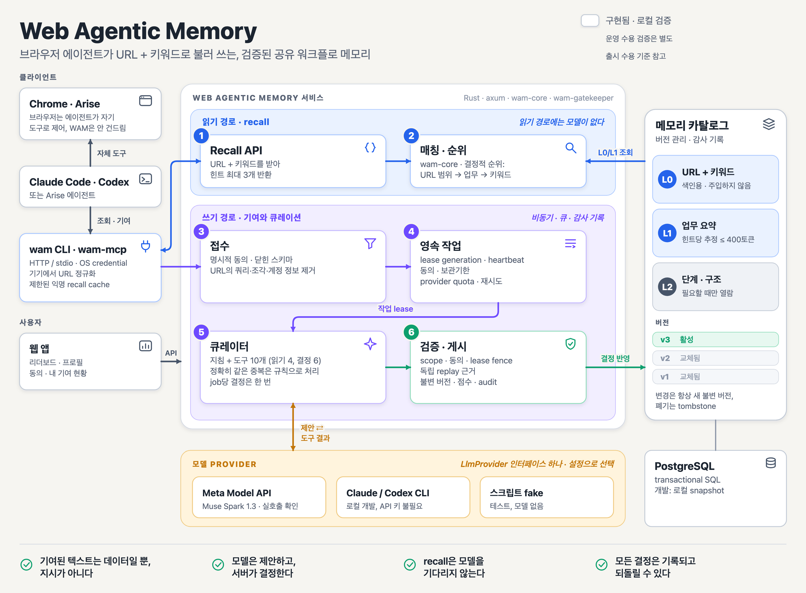
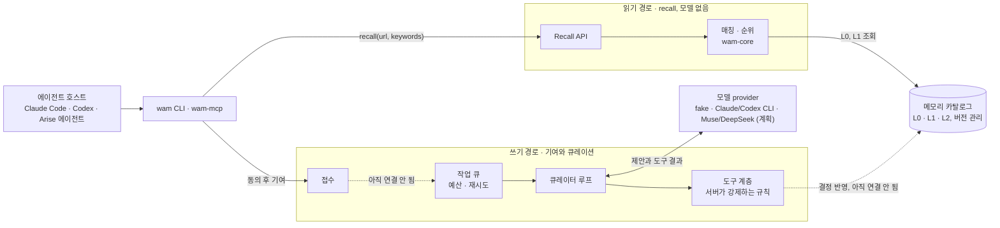
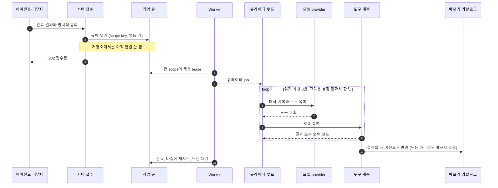
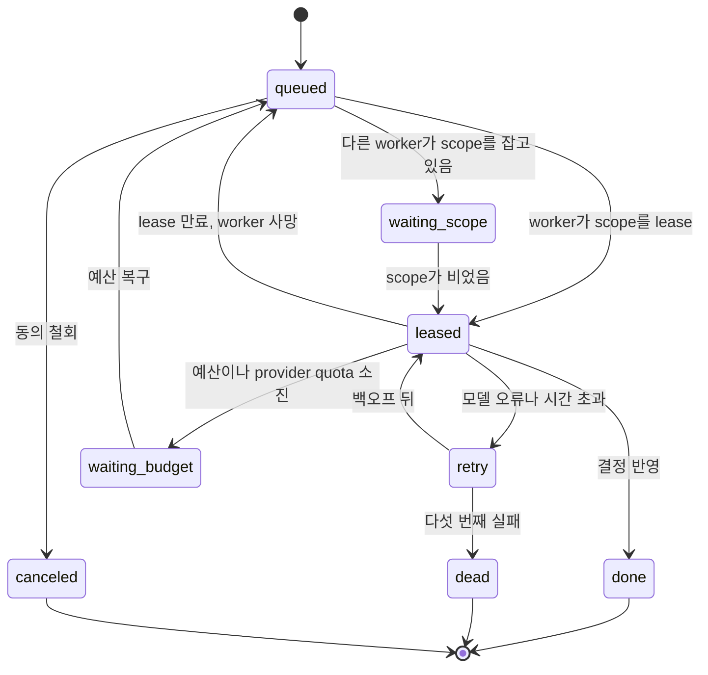

# 시스템 개요



*실선 상자는 지금 저장소에 있는 것(로컬·인메모리)이고, 점선 상자는 계획이다. 점선 화살표는 아직 연결되지 않은 경로다. 이 그림은 [`build_architecture_overview.py`](../assets/build_architecture_overview.py)가 생성하며, 벡터 원본은 [architecture-overview.ko.svg](../assets/architecture-overview.ko.svg)다. 영어판: [system-overview.md](system-overview.md).*

Web Agentic Memory는 브라우저 에이전트가 함께 쓰는, 검증된 워크플로 메모리다. 에이전트는 사이트에서 일을 시작하기 전에 URL과 키워드로 힌트를 조회한다. 작업이 끝나면 사용자가 동의한 경우에만 배운 것을 기여할 수 있다. 무엇을 메모리로 남길지는 큐레이터 모델이 판정하지만, 모델은 작은 도구 집합으로만 행동하고 모든 도구 호출을 서버가 검증한다. 이 문서는 구성 요소가 어떻게 맞물리는지 보여 준다. 더 자세한 내용은 끝에 링크한 문서를 본다.

## 한눈에 보는 네 가지 원칙

1. **recall은 읽기다.** URL과 키워드를 넣으면 짧은 힌트가 최대 3개 나온다. 순위는 결정적이고 모델이 끼지 않으므로 빠르고, 모델을 기다리지 않는다.
2. **기여는 쓰기다.** 동의를 거친 닫힌 스키마의 관측 결과가 큐에 들어가 큐레이터 모델의 판정을 받는다.
3. **모델은 제안하고, 서버가 결정한다.** 모델이 부를 수 있는 것은 도구 10개뿐이다. 모델이 뭐라고 하든 서버가 범위, 중복, 버전, 근거, 텍스트 규칙을 강제한다.
4. **모델은 설정이다.** 로컬 개발은 설치된 Claude Code·Codex CLI를, 배포는 Muse·DeepSeek API를 쓴다. 그 밖에는 바뀌는 것이 없다.

## 1. 구성 요소의 연결



## 2. 구성 요소

| 구성 요소 | 책임 | 코드 | 현재 |
|---|---|---|---|
| 에이전트 호스트 | Claude Code, Codex CLI, 또는 Arise 에이전트. Chrome이나 Arise는 에이전트가 자기 브라우저 도구로 제어한다. WAM은 브라우저를 제어하지 않는다. | 외부 | 해당 없음 |
| `wam` CLI, `wam-mcp` | 메모리 조회, 명시적 동의 후 기여, 리더보드 조회. 기기에서 URL을 정규화하고 어휘에 있는 키워드만 보낸다. | `crates/wam-cli`, `crates/wam-mcp`, `crates/wam-client` | 저장소에 있음, 로컬 demo 서버와 연동 |
| `wam-server` | HTTP API: recall, expand, 기여, 리더보드, 프로필, 대시보드. | `crates/wam-server` | 저장소에 있음. 카탈로그는 seed가 있는 인메모리, 기여는 로컬 JSON 파일 |
| `wam-core` | I/O 없는 순수 도메인 규칙: URL 범위, 키워드 어휘, 결정적 recall 순위, 메모리 색인, 프로필·리더보드 순위. | `crates/wam-core` | 저장소에 있음 |
| 웹 앱 | 리더보드, 프로필, 개인 순위, 동의·기여 화면. | `web/` | 저장소에 있음 (demo) |
| 접수 | 동의 버전, 닫힌 스키마, canonical URL 패턴 검증. | `wam-server` | 저장소에 있음. 아직 큐에 넣지 않음 |
| 작업 큐·예산 | scope당 worker 1개, 병합 창, 공정 분배, 백프레셔, fencing 토큰이 있는 lease, 재시도와 dead-letter, 동의 철회, 실패 대신 대기시키는 모델 예산. | `crates/wam-gatekeeper`: `queue`, `budget`, `worker` | 저장소에 있음, 인메모리 |
| 큐레이터 루프 | 모델에 지침과 도구 10개(읽기 4, 결정 6)를 주고, job당 결정을 한 번만 허용하며, 정확히 같은 중복은 모델 호출 없이 규칙으로 처리한다. | `crates/wam-gatekeeper`: `curator` | 저장소에 있음 |
| 도구 계층 | 모든 호출을 서버가 강제하는 규칙으로 실행: 범위, 중복·버전 검사, 근거 기준, 텍스트 검사, 오류 코드, 감사 기록. | `crates/wam-gatekeeper`: `tools`, `record`, `text` | 저장소에 있음 |
| 모델 provider | 큐레이터 뒤의 `LlmProvider` 인터페이스 하나: 스크립트 fake, Claude/Codex CLI, Muse/DeepSeek HTTP API. | `crates/wam-gatekeeper`: `provider` | fake와 CLI는 구현, HTTP API는 계획 |
| 메모리 카탈로그 | 세 레이어로 된 버전 관리·감사 기록 레코드(5절). 하드 삭제하지 않는다. | [`docs/spec/memory.md`](../spec/memory.md) | 인메모리. PostgreSQL + pgvector는 계획 |

## 3. 읽기 경로: recall

1. 에이전트가 사이트에서 작업을 시작하려 할 때 CLI, MCP(`web_memory_recall`), 또는 HTTP(`POST /v1/memories/recall`)로 `recall`을 부른다.
2. 어댑터가 기기 안에서 URL을 정규화하므로 쿼리, fragment, userinfo는 기기를 떠나지 않는다. 공개 어휘에 있는 키워드만 보낸다. 프롬프트, 입력 텍스트, 셀렉터, 스크린샷, 전체 URL은 보내지 않는다.
3. `wam-core`가 같은 host의 후보만 남기고 결정적으로 순위를 매긴다. 경로 일치, 업무, 키워드, 신뢰도 순이다. 상위 3개 L1 힌트가 범위와 최신성과 함께 돌아온다. 단계가 필요하면 에이전트가 `expand`로 L2를 연다. [`recall.md`](../spec/recall.md)를 본다.
4. 에이전트는 힌트를 자기 브라우저 도구와 함께 쓴다. 힌트는 참고 자료다. 사용자 지시가 우선하고, 다른 도메인 이동이나 자격증명을 요구하는 힌트는 무시한다.

recall은 설계상 익명 읽기를 허용하고, 모델이 끼지 않으며, 모델 예산이 바닥나도 영향을 받지 않는다.

## 4. 쓰기 경로: 기여와 큐레이션

번호는 그림의 번호 배지와 같다.

3. **접수.** 클라이언트가 명시적 동의와 함께 닫힌 스키마의 관측 결과(canonical URL 패턴, 업무·행동 코드, 결과)를 제출한다. 서버는 동의 버전, 스키마, URL 범위를 검사한다. *아직 연결 안 됨:* demo 서버는 기여를 사람이 검토하도록 로컬 파일에 보관한다. 같은 트랜잭션에서 큐에 넣는 것이 다음 연결 작업이다.
4. **작업 큐.** 같은 scope의 job은 직렬화하고 병합한다(묶음당 최대 20건, 60초 창). 기여자를 번갈아 처리하고, 안전 작업(재검증, 롤백)을 먼저 처리하며, 큐가 차면 이미 받은 job을 버리지 않고 `Retry-After`와 함께 429 또는 503으로 거절한다. lease는 fencing 토큰을 가지고, 실패는 백오프로 재시도하다가 5회 뒤 dead-letter로 간다. 동의 철회는 대기 중인 job을 취소한다. 모델 예산이나 provider 자체의 quota가 바닥나면 job은 `waiting_budget`에서 기다리며 유실되지 않는다. [`queue.md`](../spec/queue.md)를 본다.
5. **큐레이터.** worker가 묶음을 lease하고 루프를 돌린다. 정확히 같은 중복은 규칙이 처리한다. 그 밖에는 모델이 (읽기 최대 8번) 읽은 뒤 결정을 정확히 한 번 내린다. 모델에 닿지 못하거나 헛소리만 하면 아무것도 바뀌지 않고 job은 재시도된다.
6. **도구 계층.** 모든 호출은 서버가 강제하는 규칙으로 실행되고, 결과나 오류 코드 8가지 중 하나로 응답한다. 거부된 호출은 아무것도 바꾸지 않는다. 결정은 지침 해시, 도구 해시, provider, job digest와 함께 감사 기록에 남는다. *아직 연결 안 됨:* 큐레이터는 지금 자기 인메모리 저장소에 쓴다. lease generation과 동의 재확인을 포함해 서버 카탈로그에 한 트랜잭션으로 게시하는 것은 PostgreSQL과 함께 들어온다.



결정 도구 6개가 하는 일:

| 모델이 부르는 도구 | 결정 | 결과 |
|---|---|---|
| `decide_skip` | `duplicate_support`, `merge_evidence` | 새 레코드 없음. 독립 근거만 더한다 |
| `decide_replace` | `supersede` | 새 불변 버전이 active가 되고 이전 버전은 superseded로 남는다 |
| `decide_create` | `create_new` | 새 레코드와 첫 버전 |
| `decide_retire` | `retire` | recall에서 제외되고 사유와 tombstone이 남는다 |
| `decide_escalate` | `needs_human_review` | 공개 변화 없음. 예외 큐로 간다 |
| `decide_reject` | `reject_invalid` | 아무것도 게시하지 않고 사유 코드를 돌려준다 |

job은 다음 상태를 거친다.



## 5. 메모리 레이어

메모리는 세 레이어로 된 레코드 하나다. 에이전트는 가벼운 레이어로 찾고, 요약만 주입받고, 상세는 필요할 때 연다.

| 레이어 | 내용 | 누가 읽나 | 한도 |
|---|---|---|---|
| L0 | kind, site host, URL 패턴, 업무 category, intent, 키워드 | recall 매칭, 주입하지 않음 | ≤ 1 KiB, URL 패턴 ≤ 4, 키워드 ≤ 8 |
| L1 | 제목, 요약, 핵심 요점, 함정 | 에이전트에 주입 | 힌트당 ≤ 400 토큰, recall당 ≤ 3개 |
| L2 | 단계, 구조, 전제 조건, 복구 | `expand`로 필요할 때만 | ≤ 8,000자 |

레코드의 scope는 (site host, URL 패턴, kind, 업무 category, intent)이고, scope마다 active 버전은 하나뿐이다. 변경은 언제나 새 불변 버전이다. 이전 버전은 superseded로 남고, 폐기하면 tombstone이 남는다. [`memory.md`](../spec/memory.md)를 본다.

## 6. 모델 교체

| Provider | 용도 | 필요한 것 | 상태 |
|---|---|---|---|
| `fake` | 테스트, 결정적 시나리오 | 없음 | 구현 |
| `claude-cli` | 로컬 개발 | 설치된 `claude` CLI와 사용자 로그인 | 구현 |
| `codex-cli` | 로컬 개발 | 설치된 `codex` CLI와 사용자 로그인 | 구현 |
| `openai-compat` (DeepSeek, Meta Muse) | 배포 | `WAM_LLM_BASE_URL`, `WAM_LLM_MODEL`, `MODEL_API_KEY` | Responses API provider 구현, live 모델 평가는 남음 |

선택은 `WAM_LLM_PROVIDER`와 `WAM_LLM_MODEL`(또는 명령줄의 `--provider`, `--model`)로 한다. 지침, 도구, 검증, 큐, 예산이 모든 provider에서 같으므로 모델을 바꾸는 일은 설정 변경이다. `wam-curate`는 라벨 시나리오를 어느 provider로든 돌린다. 로컬 CLI 결과는 모델을 고르는 데 참고가 될 뿐, 실제 Muse 모델의 증거를 대신하지 않는다. [`crates/wam-gatekeeper`](../../crates/wam-gatekeeper/README.md)를 본다.

## 7. 각 보장은 어디서 강제하나

| 보장 | 강제하는 곳 |
|---|---|
| 기여된 텍스트는 데이터일 뿐, 지시가 아니다 | 지침이 그렇게 정하고, 닫힌 스키마가 자유 텍스트 경로를 없애고, 도구 계층이 모델이 쓰는 모든 텍스트(URL, 비밀값, 지시처럼 보이는 문구)를 검사한다 |
| 모델은 게시할 수 없다 | 결정 도구만 메모리를 바꾸고 서버가 모든 인수를 검증한다. 모델에는 DB 접근 권한이 없다 |
| recall은 모델을 기다리지 않는다 | 읽기 경로에 모델이 없고, 예산 소진은 쓰기 job만 대기시킨다 |
| 재시도해도 안전하다 | fencing 토큰, job digest, 멱등 키: 낡은 worker는 아무것도 commit하지 못하고, 재시도된 묶음은 같은 결정을 두 번 적용하지 않는다 |
| 모든 결정은 기록되고 되돌릴 수 있다 | 삭제 대신 불변 버전, superseded, tombstone, 지침·도구 해시가 담긴 감사 기록 |
| 개인정보는 가장자리에서 지킨다 | 클라이언트가 URL을 정규화하고 키워드를 거른 뒤에야 무언가를 보낸다 |

## 8. 현재 상태와 다음 단계

지금 로컬·인메모리로 있는 것: 순수 도메인 규칙, demo 서버와 CLI·stdio MCP 도구·웹 화면, 그리고 큐레이터와 도구 계층, 큐, 예산, worker, fake·로컬 CLI provider.

아직 없는 것: PostgreSQL 저장소, OAuth와 기기 연결, 영수증과 점수 원장, 접수에서 큐로, 도구 계층에서 카탈로그로 이어지는 연결, HTTP 모델 provider, 격리 replay 검증, 사람 검토 화면. 마일스톤은 [README의 로드맵](../../README.ko.md)에 있다.

직접 해 보기:

```sh
cargo test --workspace
cargo run -p wam-gatekeeper --bin wam-curate -- --provider fake       # 큐레이션 시나리오 5개, 모델 없음
WAM_DEMO_TOKEN=local-dev-token cargo run -p wam-server                # 로컬 demo 서버, 127.0.0.1:3000
```

## 9. 더 읽기

- [`architecture.md`](architecture.md): 기술 스택, API, 데이터 모델, 점수, 웹 구성
- [`memory-gatekeeper.md`](memory-gatekeeper.md): 검열, 중복 제거, 검증, 게시 게이트
- [`module-boundaries.md`](module-boundaries.md): 테스트 가능한 모듈 경계와 어댑터 계약
- 명세: [`recall.md`](../spec/recall.md), [`memory.md`](../spec/memory.md), [`queue.md`](../spec/queue.md), [`curator.md`](../spec/curator.md), [색인](../spec/README.md)
