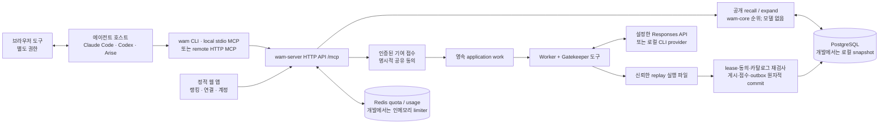

# 시스템 개요


*2026-10-30 구현 기준. 실선 상자와 연결은 저장소의 코드와 로컬 검증을 나타내며 운영 수용 검증 완료를 뜻하지 않는다. [`build_architecture_overview.py`](../assets/build_architecture_overview.py)가 그림을 생성하고, 벡터 원본은 [architecture-overview.ko.svg](../assets/architecture-overview.ko.svg)다. 영어판: [system-overview.md](system-overview.md).*

Web Agentic Memory는 브라우저 에이전트가 승인된 작업 힌트를 공유하는 시스템이다. 에이전트가 공개 URL과 어휘 키워드로 명시적으로 recall한다. 로그인한 사용자는 공유에 동의한 canonical URL과 고정 업무·행동 코드를 기여할 수 있다. 모델은 닫힌 도구로 결정을 제안하며, 서버 규칙과 독립 replay 근거가 게시를 통제한다.

## 1. 구성 요소의 연결



외부에 공개하는 메모리 도구 10개와 큐레이터 내부의 읽기·결정 도구 10개는 서로 다른 catalog다. WAM은 브라우저 제어를 설치하거나 인계받지 않는다. 선택적 로컬 `wam browser-mcp` bridge는 브라우저 MCP child를 유지하고 명시적으로 호출하는 현재 탭 recall 도구를 추가한다. Background 주입은 제공하지 않는다.

## 2. 구현된 구성 요소

| 구성 요소 | 책임과 구현 |
|---|---|
| `wam-core` / `wam-contracts` | URL 정규화, 닫힌 요청·응답 계약, 메모리 레이어, 결정적 순위, 프로필·점수 규칙 |
| `wam-client`, CLI, stdio MCP | endpoint에 바인딩한 OS credential, 익명 recall cache, 로컬 URL 정규화, 계정 연결, 호스트 등록·제거, instruction 스니펫 |
| 원격 `/mcp` | 공용 JSON-RPC dispatcher, 도구 10개, JSON/SSE 응답, body 상한, exact Origin과 OAuth scope 검사 |
| 웹 | 공개 리더보드·catalog·프로필, 설치 가이드, GitHub 로그인, 개인 dashboard·analytics, 기여·동의·계정 삭제·device 설정, 검수 화면 |
| `wam-server::ApplicationRepository` | application·identity·기여·불변 버전·receipt·점수 원장·work·audit·outbox를 하나의 transactional repository로 관리 |
| 저장소 | PostgreSQL SQL migration과 adapter. 개발 모드는 잠긴 atomic 로컬 snapshot 하나를 쓴다. 현재 구현에 pgvector는 필수가 아니다 |
| 요청 제한·진단 | Redis 공유 weighted quota와 본인 usage, process별 load shed, SQLite/PostgreSQL의 trace 연결·redacted diagnostics |
| Application worker | 영속 lease·heartbeat·retry, 트랜잭션 밖의 Gatekeeper 평가·replay와 fenced commit. 별도 PostgreSQL worker 또는 개발용 in-process worker |
| Gatekeeper library | curator/tools와 재사용 가능한 memory/PostgreSQL queue·budget backend. Scope-batch queue는 application 기여 work 테이블과 구분한다 |
| 모델 provider | scripted test provider, 설치된 Claude/Codex CLI, HTTP Responses API adapter. 실모델 품질과 endpoint 호환성은 별도 검증 |

## 3. 읽기 경로

1. CLI·local MCP·선택적 browser bridge는 WAM API 요청 전에 URL을 정규화하고 키워드를 거른다. 직접 연결하는 remote client도 canonical 공개 URL 계약을 지켜야 하고 서버가 다시 검사한다. 이 경계는 WAM 요청에 관한 것이며 host의 다른 모델·브라우저 통신을 보장하지 않는다.
2. `POST /v1/memories/recall` 또는 `web_memory_recall`이 active 공개 레코드를 걸러 core ranker를 적용한다. 모델을 부르지 않는다. PostgreSQL 배포 catalog는 비어 있는 상태로 시작하며 demo seed는 로컬 개발 파일 저장소에만 있다.
3. 힌트는 최대 3개이며 **각각 추정 400토큰 이하**다. metadata와 상세 조회는 별도다. `web_memory_expand`는 recall된 불변 `version_id`를 지정해 최신 버전으로 조용히 바뀌는 것을 피할 수 있다.
4. 익명 조회에는 점수가 없다. 인증된 recall은 owner-bound receipt를 발급할 수 있다. 성공 outcome에서 receipt의 사용 버전을 명시했고 다른 active author의 버전일 때만 +2가 생기며 재시도는 중복 적립하지 않는다.

HTTP와 MCP는 같은 동작별 비용을 쓴다. 일반·연결 탐색 조회 1, recall 3, expand 2, 쓰기 5다. Status/usage는 별도 bounded bucket이다. 알 수 없는 method/tool과 잘못된 MCP envelope는 쓰기 비용을 유지한다. [요청 제한 명세](../spec/rate-limits.md)를 따른다.

## 4. 기여에서 게시까지

1. 접수가 인증·공유 동의·canonical URL·업무/행동 enum·선택적 멱등 nonce를 검사한다. 기여·동의·영속 work를 함께 commit한다.
2. `wam-worker`가 generation과 owner token으로 기여 work를 claim하고 heartbeat로 lease를 연장한다. 모델과 replay 실행은 application transaction 밖에서 한다.
3. 독립 replay 근거를 확인하고 카탈로그 snapshot에서 큐레이터를 실행한다. 모델은 DB에 직접 접근하지 못하며 자기 replay를 증명할 수 없다.
4. 신뢰한 replay executable이 제안 레코드를 검증한다. 근거는 정확한 요청 digest와 최소 3회 성공을 바인딩하고, 성공률 개선 또는 성공률 저하 없는 tool call 감소를 요구한다. 상수를 반환하는 fixture는 배포 근거가 아니다.
5. Commit 직전에 lease generation/holder·catalog digest·동의·active 계정·scope·schema를 다시 검사한다. 불변 버전·귀속·게시 +20·decision/audit·outbox를 원자적으로 반영한다. 충돌이나 만료 동의에서 일부만 게시할 수 없다.
6. 낮은 confidence와 escalate는 검수를 기다린다. 검수는 replay가 검증된 proposal만 바로 게시하며, 검증 전 승인은 검증 작업만 요청한다. Provider quota 대기는 실패 횟수를 차감하지 않고 재시도한다. 철회와 보관기한 만료는 대기 work를 무효화한다.

```mermaid
sequenceDiagram
    participant U as 로그인한 사용자
    participant S as 접수 / repository
    participant W as Worker
    participant R as 신뢰한 replay
    participant C as 큐레이터 + provider
    U->>S: canonical URL, 행동 코드, 명시적 동의
    S->>S: transaction: 기여 + 동의 + work
    S-->>U: 기여 receipt
    W->>S: 영속 lease claim / renew
    W->>R: 관측 candidate와 digest 검증
    W->>C: catalog snapshot 기반 평가
    C-->>W: 검증한 결정 proposal
    W->>R: 제안 레코드 독립 검증
    W->>S: fence 재검사; 버전·점수·audit·outbox atomic commit
```

Standalone Gatekeeper queue의 병합·공정 분배·budget 상태기는 [queue.md](../spec/queue.md)에 있다. 그 backend의 모든 기능이 application worker에 활성화됐다고 추정하지 않는다. 실제 통합은 [`durable/worker.rs`](../../crates/wam-server/src/durable/worker.rs)가 기준이다.

## 5. 메모리와 provider 계약

| 레이어 | 내용 | 한도 |
|---|---|---|
| L0 | URL scope, kind, 업무, intent, 어휘 키워드 | 최대 1 KiB·패턴 4개·키워드 8개 |
| L1 | 제목·요약·핵심 요점·함정 | 힌트당 추정 400토큰 이하, 최대 3개 |
| L2 | 단계·구조·전제 조건·복구 | 최대 8,000자, 명시적으로 조회 |

변경은 불변 버전을 추가한다. 메모리가 공개인 동안 superseded 버전은 ID로 expand할 수 있고, retired 버전은 숨긴다. [memory](../spec/memory.md)·[recall](../spec/recall.md)을 따른다.

`WAM_LLM_PROVIDER`와 `WAM_LLM_MODEL`로 provider를 고른다. `openai-compat`에는 `MODEL_API_KEY`와 실제로 `<WAM_LLM_BASE_URL>/responses`를 지원하는 endpoint가 필요하다. Provider 별칭이 실호환성 증거는 아니다. Fake provider는 scenario/test용이며 live worker는 거부한다. [Gatekeeper 설정](../../crates/wam-gatekeeper/README.md)을 참고한다.

## 6. 배포 상태

구현·로컬 검증됨: PostgreSQL application 영속성, Redis 요청 제한, GitHub/session/device 및 remote MCP OAuth protocol, transactional publication·receipt·ledger, 검수, 삭제·보관기한, JSON/SSE 전송. 로컬 OAuth·모델·replay 대역은 application 연결을 검증하며 실제 provider 수용 시험을 대신하지 않는다.

출시 때는 candidate 하나를 고정하고 [운영 배포 절차](../operations/deployment.md)와 [출시 수용 기준](../test/release-readiness.md)을 따른다. 실제 GitHub·광고하는 host, native OS store·artifact 설치, 운영 복구·부하·TLS, 독립 모델/replay 평가, 라이선스·reference 권리·작동하는 비공개 보안 연락 경로는 별도 근거가 필요하다. GitHub Actions 워크플로우는 포함하지 않는다.

```sh
cargo test --workspace --locked
cargo run -p wam-gatekeeper --bin wam-curate -- --provider fake
cargo run -p wam-server --locked
```

이 명령은 개발·scenario 경로를 실행한다. 설정된 운영 worker를 시작하거나 바이너리를 공개 배포하는 명령이 아니다.

추가 계약: [아키텍처](architecture.md), [모듈 경계](module-boundaries.md), [기능 인덱스](../spec/README.md), [서버 설정](../../crates/wam-server/README.md).
