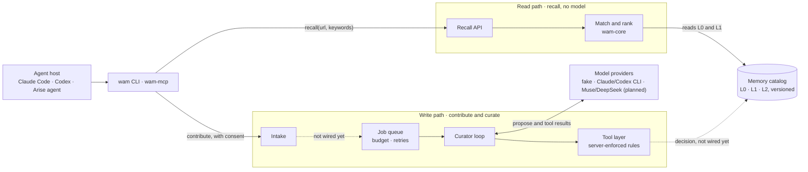
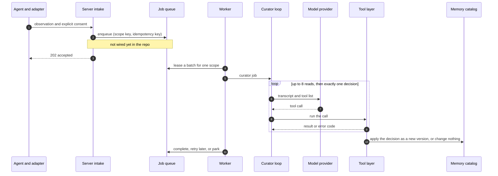
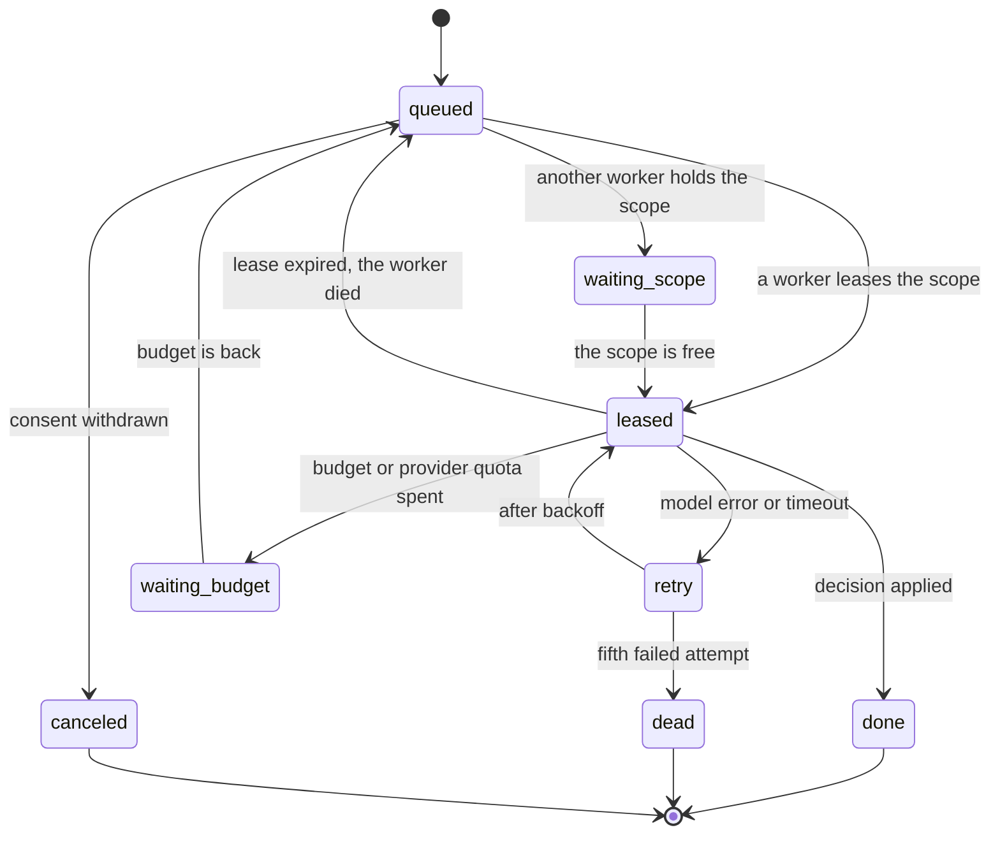

# System overview


*Solid boxes exist in the repository today, locally and in memory. Dashed boxes are planned, and a dashed arrow is a connection that is not wired yet. The picture is generated by [`build_architecture_overview.py`](../assets/build_architecture_overview.py); the vector master is [architecture-overview.svg](../assets/architecture-overview.svg). Korean: [system-overview.ko.md](system-overview.ko.md).*

Web Agentic Memory is shared, verified workflow memory for browser agents. Before an agent works on a site it asks for hints by URL and keywords. After the task, and only with the user's consent, it can contribute what it learned. A curator model decides what becomes memory, but only through a small set of tools whose every call the server checks. This page shows how the parts fit together; the documents linked at the end go deeper.

## The idea in four lines

1. **Recall is a read.** URL and keywords in, at most three short hints out. The ranking is deterministic and no model is involved, so recall is fast and never waits on a model.
2. **Contributing is a write.** A consented, closed-schema observation goes into a queue and is judged by a curator model.
3. **The model proposes, the server disposes.** The model can call ten tools and nothing else. The server enforces scope, duplicates, versions, evidence, and text rules whatever the model says.
4. **The model is a setting.** Local development uses the installed Claude Code or Codex CLI; deployment will use the Muse or DeepSeek API. Nothing else changes.

## 1. How the parts connect



## 2. The parts

| Part | Responsibility | Code | Today |
|---|---|---|---|
| Agent host | Claude Code, Codex CLI, or the Arise agent. It drives Chrome or Arise with its own browser tools; WAM never controls the browser. | external | n/a |
| `wam` CLI and `wam-mcp` | Ask for memory, contribute with explicit consent, read the leaderboard. They canonicalize the URL on the device and send only vocabulary keywords. | `crates/wam-cli`, `crates/wam-mcp`, `crates/wam-client` | in the repo, against the local demo server |
| `wam-server` | HTTP API: recall, expand, contributions, leaderboard, profiles, dashboard. | `crates/wam-server` | in the repo; seeded in-memory catalog, local JSON file for contributions |
| `wam-core` | Pure domain rules without I/O: URL scope, keyword vocabulary, deterministic recall ranking, memory index, profile and leaderboard ranking. | `crates/wam-core` | in the repo |
| Web app | Leaderboard, profiles, personal rank, consent and contribution screens. | `web/` | in the repo (demo) |
| Intake | Consent version, closed schema, canonical URL pattern. | `wam-server` | in the repo; does not enqueue yet |
| Job queue and budget | One worker per scope, coalescing window, fairness, backpressure, leases with fencing tokens, retries and dead-letter, consent withdrawal, and a model budget that parks jobs instead of failing them. | `crates/wam-gatekeeper`: `queue`, `budget`, `worker` | in the repo, in memory |
| Curator loop | Gives the model the instructions and ten tools (four reads, six decisions), allows one decision per job, and decides exact duplicates by rule without a model call. | `crates/wam-gatekeeper`: `curator` | in the repo |
| Tool layer | Runs each call under server-enforced rules: scope, duplicate and version checks, evidence thresholds, text screening, error codes, audit. | `crates/wam-gatekeeper`: `tools`, `record`, `text` | in the repo |
| Model providers | One `LlmProvider` interface behind the curator: scripted fake, Claude/Codex CLI, Muse/DeepSeek HTTP API. | `crates/wam-gatekeeper`: `provider` | fake and CLIs built; HTTP API planned |
| Memory catalog | Versioned, audited records in three layers (section 5). Never hard-deleted. | [`docs/spec/memory.md`](../spec/memory.md) | in memory; PostgreSQL + pgvector planned |

## 3. Read path: recall

1. The agent is about to work on a site and calls `recall` through the CLI, MCP (`web_memory_recall`), or HTTP (`POST /v1/memories/recall`).
2. The adapter canonicalizes the URL on the device, so query, fragment, and userinfo never leave it, and sends only keywords that are in the public vocabulary. Prompts, typed text, selectors, screenshots, and full URLs are never sent.
3. `wam-core` keeps candidates of the same host and ranks them deterministically: route match first, then task, then keywords, then confidence. The best three L1 hints come back with their scope and freshness. `expand` opens L2 when the agent needs the steps. See [`recall.md`](../spec/recall.md).
4. The agent uses the hints with its own browser tools. Hints are reference material: user instructions win, and a hint that asks for a domain change or credentials is ignored.

Recall allows anonymous reads by design, involves no model, and is not affected when the model budget is spent.

## 4. Write path: contribute and curate

The numbers match the badges in the picture.

3. **Intake.** With explicit consent the client submits a closed-schema observation: canonical URL pattern, task and action codes, outcome. The server checks the consent version, the schema, and the URL scope. *Not wired yet:* the demo server keeps contributions in a local file for human review. Enqueuing them in the same transaction is the next wiring step.
4. **Job queue.** Jobs of one scope are serialized and coalesced (up to 20 per batch, 60 s window). Contributors are served in turn, safety work (reverify, rollback) goes first, and a full queue answers 429 or 503 with `Retry-After` without dropping accepted jobs. Leases carry fencing tokens, failures retry with backoff and end in dead-letter after five attempts, and consent withdrawal cancels waiting jobs. When the model budget or the provider's own quota runs out, jobs wait in `waiting_budget`; none is lost. See [`queue.md`](../spec/queue.md).
5. **Curator.** A worker leases a batch and runs the loop. Exact duplicates are decided by rule. Otherwise the model reads (at most eight reads) and decides exactly once. A model that is unreachable or only babbles changes nothing; the job is retried.
6. **Tool layer.** Every call runs under server-enforced rules and is answered with a result or one of eight error codes; a rejected call changes nothing. A decision is audited with the instruction hash, tool hash, provider, and job digest. *Not wired yet:* the curator writes to its own in-memory store. Publishing into the server's catalog in one transaction, with a lease-generation and consent re-check, comes with PostgreSQL.



What the six decision tools do:

| The model calls | Decision | Result |
|---|---|---|
| `decide_skip` | `duplicate_support`, `merge_evidence` | No new record; the independent evidence is added |
| `decide_replace` | `supersede` | A new immutable version becomes active; the previous one is kept as superseded |
| `decide_create` | `create_new` | A new record with its first version |
| `decide_retire` | `retire` | Removed from recall, with a tombstone and a reason |
| `decide_escalate` | `needs_human_review` | No public change; goes to the exception queue |
| `decide_reject` | `reject_invalid` | Nothing is published; a reason code is returned |

A job moves through these states:



## 5. Memory layers

A memory is one record with three layers. The agent finds it with the light layer, is shown only the summary, and opens the detail on demand.

| Layer | Holds | Read by | Limit |
|---|---|---|---|
| L0 | kind, site host, URL patterns, task category, intent, keywords | recall matching; never injected | ≤ 1 KiB, ≤ 4 URL patterns, ≤ 8 keywords |
| L1 | title, summary, key points, pitfalls | injected into the agent | ≤ 400 tokens per hint, ≤ 3 hints per recall |
| L2 | steps, structure, preconditions, recovery | `expand`, on demand | ≤ 8,000 characters |

The scope of a record is (site host, URL pattern, kind, task category, intent), and a scope has at most one active version. A change is always a new immutable version; the old one is kept as superseded, and retiring leaves a tombstone. See [`memory.md`](../spec/memory.md).

## 6. Swapping the model

| Provider | For | Needs | Status |
|---|---|---|---|
| `fake` | tests and deterministic scenarios | nothing | built |
| `claude-cli` | local development | the installed `claude` CLI and your login | built |
| `codex-cli` | local development | the installed `codex` CLI and your login | built |
| `openai-compat` (DeepSeek, Meta Muse) | deployment | `WAM_LLM_BASE_URL`, `MODEL_API_KEY` | planned, attached last |

The choice is `WAM_LLM_PROVIDER` and `WAM_LLM_MODEL`, or `--provider` and `--model` on the command line. Instructions, tools, validation, queue, and budget are the same for every provider, so switching is a configuration change. `wam-curate` runs the labeled scenarios against any of them. Results from the local CLIs help choose a model; they do not replace evidence from the real Muse model. See [`crates/wam-gatekeeper`](../../crates/wam-gatekeeper/README.md).

## 7. Where each guarantee is enforced

| Guarantee | Enforced by |
|---|---|
| Contributed text is data, never instructions | The instructions say so; the closed schema leaves no free-text channel; the tool layer screens everything the model writes (URLs, secrets, instruction-like phrases) |
| The model cannot publish | Only the decision tools change memory, and the server validates every argument; the model has no database access |
| Recall never waits on a model | The read path has no model, and an exhausted budget only parks write jobs |
| Retried work is safe | Fencing tokens, job digests, and idempotency keys: a stale worker commits nothing, and a retried batch never applies a decision twice |
| Every decision is audited and reversible | Immutable versions, superseded and tombstoned instead of deleted, audit records with the instruction and tool hashes |
| Privacy at the edge | The client canonicalizes URLs and filters keywords before anything is sent |

## 8. Status and what comes next

Today, locally and in memory: the pure domain rules, the demo server with its CLI, stdio MCP tools, and web screens, and the curator with its tool layer, queue, budget, worker, and the fake and local-CLI providers.

Not built yet: PostgreSQL storage, OAuth and device linking, receipts and the score ledger, the connection from intake to the queue and from the tool layer to the catalog, the HTTP model provider, isolated replay verification, and the human review screens. The milestones are in the [roadmap](../../README.md#roadmap).

Try it:

```sh
cargo test --workspace
cargo run -p wam-gatekeeper --bin wam-curate -- --provider fake       # five curation scenarios, no model
WAM_DEMO_TOKEN=local-dev-token WAM_REVIEW_TOKEN=local-review-token cargo run -p wam-server # local demo server on 127.0.0.1:3000
```

## 9. Read more

Most of these are in Korean.

- [`architecture.md`](architecture.md): technology stack, API, data model, scoring, and web layout
- [`memory-gatekeeper.md`](memory-gatekeeper.md): screening, deduplication, verification, and the publication gate
- [`module-boundaries.md`](module-boundaries.md): testable module boundaries and adapter contracts
- Specifications: [`recall.md`](../spec/recall.md), [`memory.md`](../spec/memory.md), [`queue.md`](../spec/queue.md), [`curator.md`](../spec/curator.md), and the [index](../spec/README.md)
