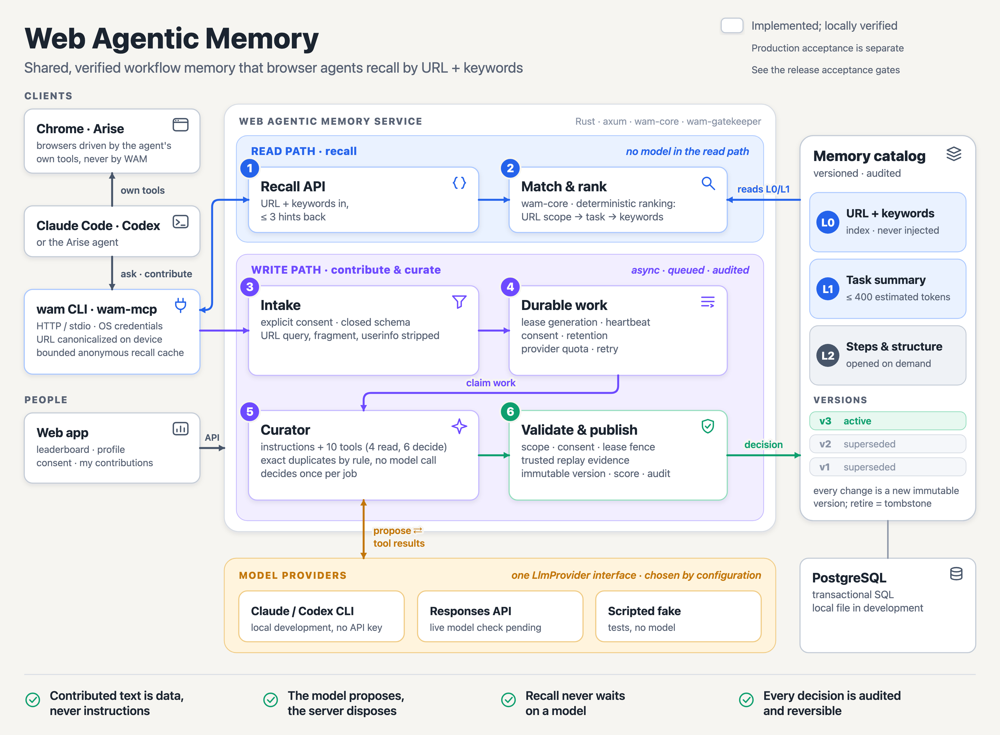
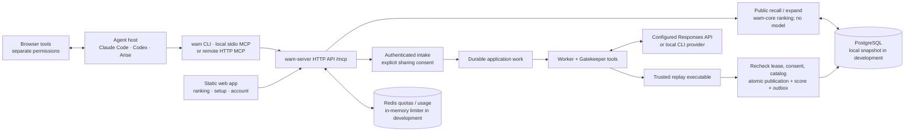

# System overview



*Implementation status checked on 2026-10-30. Solid boxes and connections describe code in this repository and local verification, not production acceptance. The picture is generated by [`build_architecture_overview.py`](../assets/build_architecture_overview.py); the vector master is [architecture-overview.svg](../assets/architecture-overview.svg). Korean: [system-overview.ko.md](system-overview.ko.md).*

Web Agentic Memory shares approved workflow hints between browser agents. An agent explicitly recalls hints by public URL and vocabulary keywords. A signed-in user can contribute a canonical URL and fixed task/action codes with explicit sharing consent. A model proposes a decision through closed tools; server rules and independent replay evidence control publication.

## 1. How the parts connect



The ten public-facing memory tools and the curator's ten internal decision/read tools are separate catalogs. WAM does not install or take over browser control. The optional local `wam browser-mcp` bridge preserves a browser MCP child and adds an explicitly invoked current-tab recall tool; it is not background injection.

## 2. Implemented components

| Component | Responsibility and implementation |
|---|---|
| `wam-core` / `wam-contracts` | URL normalization, closed request/response contracts, memory layers, deterministic ranking, profile and score rules |
| `wam-client`, CLI, stdio MCP | Endpoint-bound OS credentials, anonymous recall cache, local URL normalization, account linking, host registration/removal and instruction snippets |
| Remote `/mcp` | Shared JSON-RPC dispatcher, ten tools, JSON or SSE responses, bounded bodies, exact Origin checks and OAuth scope enforcement |
| Web | Public leaderboard/catalog/profiles, setup guide, GitHub login, private dashboard/analytics, contributions, profile/consent/deletion and device settings, review console |
| `wam-server::ApplicationRepository` | Application state, identity, contributions, immutable versions, receipts, score ledger, work, audit and outbox in one transactional repository |
| Persistence | PostgreSQL SQL migrations and adapters; one locked atomic local snapshot in development. pgvector is not required by the current implementation |
| Admission / diagnostics | Shared Redis weighted quotas and owner usage; per-process load shedding; trace-linked redacted diagnostics in SQLite or PostgreSQL |
| Application worker | Durable lease/heartbeat/retry, Gatekeeper evaluation outside transactions, replay verification and fenced commit; separate PostgreSQL worker or in-process development worker |
| Gatekeeper library | Curator/tools plus reusable memory/PostgreSQL queue and budget backends. Its scope-batch queue is distinct from the application's contribution work table |
| Model provider | Scripted test provider, installed Claude/Codex CLI adapters and an HTTP Responses API adapter. Live model quality and endpoint compatibility require separate evidence |

## 3. Read path

1. CLI, local MCP or the optional browser bridge canonicalizes the URL before a WAM API request and filters keywords. Direct remote clients must respect the same canonical public-URL contract; the server validates it again. This boundary describes WAM traffic, not the host's other model or browser traffic.
2. `POST /v1/memories/recall` or `web_memory_recall` filters public active records and applies the core ranker. There is no model call. A deployment starts with an empty PostgreSQL catalog; only local development file storage supplies demo records.
3. Up to three hints are returned, **each at most 400 estimated tokens**. Metadata and detail lookups are additional. `web_memory_expand` can pin the recalled immutable `version_id` instead of silently substituting the latest version.
4. Anonymous reads do not earn points. Authenticated recall can issue an owner-bound receipt. A successful outcome awards +2 only for explicitly selected receipt versions from another active author; retries cannot award twice.

HTTP and MCP use the same operation costs: ordinary/discovery reads 1, recall 3, expand 2, writes 5. Status/usage have a separate bounded bucket. Unknown methods/tools and malformed MCP envelopes retain the write cost. See [rate limits](../spec/rate-limits.md).

## 4. Contribution to publication

1. Intake validates authentication, sharing consent, canonical URL, task/action enums and optional idempotency nonce. Contribution, consent and durable work are committed together.
2. `wam-worker` claims contribution work with a generation and owner token. A heartbeat renews the lease. Model calls and replay run outside the application transaction.
3. The worker checks independently supplied replay evidence, then runs the curator against a catalog snapshot. The model has no direct database access and cannot attest to its own replay.
4. A trusted replay executable verifies the proposed record. Evidence binds the exact request digest and at least three successful runs, with improved success or fewer tool calls without worse success. A constant fixture response is not deployment evidence.
5. Commit rechecks the lease generation/holder, catalog digest, consent, active account, scope and schema. The immutable version, attribution, +20 publication award, decision/audit and outbox commit atomically. A conflict or expired consent cannot partially publish.
6. Low confidence or escalation waits for review. Review may publish an already replay-verified proposal; approval without one only requests verification. Provider quota pauses retry without charging a failed attempt. Withdrawal and retention invalidate pending work.

```mermaid
sequenceDiagram
    participant U as Signed-in user
    participant S as Intake / repository
    participant W as Worker
    participant R as Trusted replay
    participant C as Curator + provider
    U->>S: canonical URL, action codes, explicit consent
    S->>S: transaction: contribution + consent + work
    S-->>U: contribution receipt
    W->>S: claim / renew durable lease
    W->>R: verify observed candidate + digest
    W->>C: evaluate against catalog snapshot
    C-->>W: validated decision proposal
    W->>R: independently verify proposed record
    W->>S: recheck fences; atomic version / score / audit / outbox
```

The standalone Gatekeeper queue's coalescing/fairness/budget state machine is specified in [queue.md](../spec/queue.md). Do not infer that every standalone backend feature is enabled by the application worker; its actual integration lives in [`durable/worker.rs`](../../crates/wam-server/src/durable/worker.rs).

## 5. Memory and provider contracts

| Layer | Content | Bound |
|---|---|---|
| L0 | URL scope, kind, task, intent and vocabulary keywords | At most 1 KiB, four patterns, eight keywords |
| L1 | Title, summary, key points and pitfalls | At most 400 estimated tokens per hint; up to three hits |
| L2 | Steps, structure, preconditions and recovery | At most 8,000 characters; opened explicitly |

Changes append immutable versions. Superseded public versions can be expanded by ID while the memory remains public; retired versions are hidden. See [memory](../spec/memory.md) and [recall](../spec/recall.md).

`WAM_LLM_PROVIDER` and `WAM_LLM_MODEL` select the provider. `openai-compat` requires `MODEL_API_KEY` and an endpoint that actually supports `<WAM_LLM_BASE_URL>/responses`; a provider alias is not live compatibility evidence. The fake provider belongs in scenarios/tests and is rejected by the live worker. See [Gatekeeper configuration](../../crates/wam-gatekeeper/README.md).

## 6. Deployment status

Implemented and locally tested: PostgreSQL application persistence, Redis admission, GitHub/session/device and remote MCP OAuth protocols, transactional publication/receipts/ledger, review, deletion/retention and JSON/SSE transports. Local OAuth/model/replay fixtures establish application wiring, not live provider acceptance.

Before release, fix one candidate and follow the [deployment runbook](../operations/deployment.md) and [release acceptance](../test/release-readiness.md). Live GitHub and advertised hosts, native OS stores/artifact installation, production recovery/load/TLS, independent model/replay evaluation, license/reference rights and a working private security contact still require their own evidence. GitHub Actions workflows are not included.

```sh
cargo test --workspace --locked
cargo run -p wam-gatekeeper --bin wam-curate -- --provider fake
cargo run -p wam-server --locked
```

These commands exercise development/scenario paths. They do not start a configured production worker or publish a binary release.

Further contracts: [architecture](architecture.md), [module boundaries](module-boundaries.md), [feature index](../spec/README.md), [server configuration](../../crates/wam-server/README.md).
